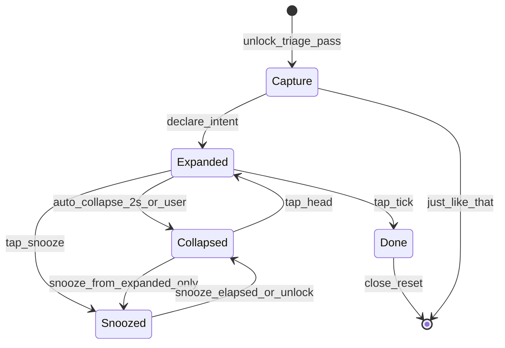
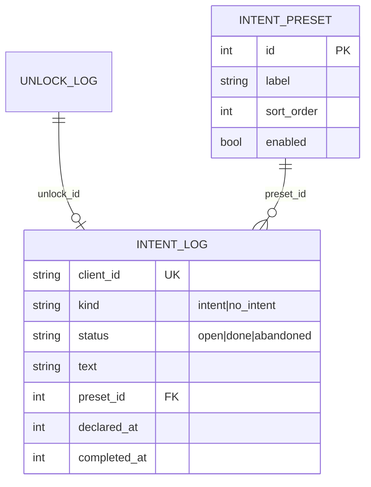

# Bubble UX — less intrusive session bubble

**Doc target on approve:** `[docs/erd/bubble-ux-hybrid-plan-2026-07-24.md](docs/erd/bubble-ux-hybrid-plan-2026-07-24.md)` (Sprint 4 archive pattern). Pointers in `[docs/BACKLOG.md](docs/BACKLOG.md)` + `[docs/PRD.md](docs/PRD.md)`. **No app code until you say implement.**

**Structure of this plan (and of the written doc):** Part I = product PRD · Part II = ERD / state · Part III = build plan · Appendix = design prompts.

---

## Locked decisions (corrected 2026-07-24)


| #        | Choice                       | Meaning                                                                                                                                                                                            |
| -------- | ---------------------------- | -------------------------------------------------------------------------------------------------------------------------------------------------------------------------------------------------- |
| **1C**   | Confirm-then-collapse hybrid | After declare → **Expanded** → after about **2s idle** → **Collapsed** (~52dp icon). **In scope** — implement when resize/collapse is feasible on-device (not deferred). Tap icon to expand again. |
| **2A**   | Snooze = temporary hide      | Hide bubble for a fixed window while unlocked; intent stays `open`. **Unlock ends snooze early** (show bubble again). Timer expiry also restores Collapsed.                                        |
| Done     | Tick (not ×)                 | Completes intent → existing `status='done'`.                                                                                                                                                       |
| Fallback | **1A only if 1C breaks**     | If auto-collapse resize is flaky on-device, ship icon-first declare without dropping Done/Snooze.                                                                                                  |


Earlier “park Snooze / ship Done only” and “prefer A as v1 default” are **withdrawn**.

Friend feedback: the fixed **200×56dp** always-on pill is too intrusive.

---

# Part I — Product PRD

## I.1 Problem

The bubble is the product wedge (`[CLAUDE.md](CLAUDE.md)` §10), but Sprint 2’s always-visible text pill + single × covers content and makes completion look like cancel.

Three backlog items are one problem: adaptive sizing, smaller footprint + richer actions, icon + tap-to-expand.

## I.2 Goals / non-goals

**Goals**

- Always-visible footprint ≈ **48–56dp** after the brief confirm expand.
- Accountability: text visible on declare (1C) and on demand (tap).
- Clear actions: **Done** (tick) vs **Snooze** (hide temporarily).
- Low-end friendly: no continuous animation; one-shot expand/collapse only.
- No schema change required for v1 (Snooze is UI-only).

**Non-goals**

- Timer ring / urgency colors (later).
- Per-preset icon picker in Manage Options (client map only).
- Multi-intent stacking; notification fallback; Kotlin unless blocked.
- Snooze as “abandon” (that would be a different product choice).

## I.3 User-facing requirements


| ID  | Requirement                                                                                                                                                  |
| --- | ------------------------------------------------------------------------------------------------------------------------------------------------------------ |
| R1  | On declare, show Expanded bubble (icon + truncated intent + Done + Snooze).                                                                                  |
| R2  | After ~2.0s idle, collapse to icon-only chat head on an edge-friendly position.                                                                              |
| R3  | Tap collapsed head → Expanded. Tap icon again (or dedicated collapse) → Collapsed.                                                                           |
| R4  | Done (tick) marks intent complete, closes overlay, restores capture-ready state.                                                                             |
| R5  | Snooze hides the overlay for a fixed duration (default **10 minutes**) while the session stays unlocked; intent remains `open`.                              |
| R5b | **Any unlock while snoozed ends snooze immediately** and re-shows the bubble (Collapsed). Same if the 10-minute timer fires first.                           |
| R6  | Expanded width adapts to text up to a max, then ellipsizes. Keep capture `intentMaxInputLength = 100`; no second “read full text” chrome in v1.              |
| R7  | Seed presets get distinct icons; custom text gets letter avatar or generic icon.                                                                             |
| R8  | Just Like That unchanged (no bubble).                                                                                                                        |
| R9  | Touches outside the small bubble window pass through.                                                                                                        |
| R10 | TalkBack / Semantics always expose full intent text when collapsed/expanded.                                                                                 |
| R11 | On configuration change (rotation / size), keep the bubble on-screen (clamp / re-anchor to a visible edge — never leave it in an obscure off-screen corner). |


## I.4 Interaction model




Snooze is offered on **Expanded** only (keeps collapsed chrome minimal). Optional later: long-press collapsed → Done; not required for v1.


| Visual state | Window             | Chrome                                                                       |
| ------------ | ------------------ | ---------------------------------------------------------------------------- |
| Expanded     | Adaptive × ~52dp   | Icon + text + Done tick + Snooze control                                     |
| Collapsed    | ~52×52dp           | Icon only                                                                    |
| Snoozed      | Closed (no window) | Background/overlay know snooze is active; unlock or timer → reopen Collapsed |
| Done         | Closed             | —                                                                            |


**Snooze duration:** hardcoded **10 minutes** for v1 (named constant). No picker UI yet.

**Snooze + lock/unlock (simplified — agreed):** unlock **cancels snooze early** and shows the bubble again, even if time remains. Rationale: unlock = “I’m back on the phone,” so hiding past that is the wrong default; it also avoids relying on the overlay isolate to notice locks. Implementation sketch: snooze closes overlay and sets a flag/`snoozeUntil` visible to the **background** engine (prefs or existing port); on `UNLOCK`, if snoozed + intent still open → clear snooze and `showOverlay` Collapsed (do **not** open a new capture). Timer expiry while still unlocked also restores Collapsed. Process death while snoozed → existing `abandoned` sweep (document as limitation).

### I.4b Long custom text (100 chars)

Keep `**intentMaxInputLength = 100**` (UI) / 500 stored defence. Do **not** shrink the capture limit for v1 — custom intents need room; presets are short anyway.

Bubble behavior: single-line ellipsis in Expanded; full string via Semantics/TalkBack. **No** extra “expand to read full paragraph” affordance in v1 — that adds chrome and fights the anti-intrusion goal. Revisit only if friend testing shows people can’t recognize their own custom text from the icon + ellipsis + tap-expand.

## I.5 Visual spec (from Stitch Prompt 1 + 4 — accepted)

Stitch Prompt 1 (states) and Prompt 4 (before/after) are the visual source of truth. Prompt 2 is useful for flow only (panel 1 wrongly invents a feed “activation”; ignore that). Prompt 3 (icon set) was illegible — use Material icons in code.

**Accepted chrome**

| Element | Spec |
|---|---|
| Fill | `#6200EE` (Material purple; close to current `Colors.deepPurple`) |
| Expanded height | **52dp** stadium |
| Expanded max width | **240dp**, single-line ellipsis |
| Collapsed | **52×52dp** circle, same fill |
| Intent icon | White Material icon, filled (`chat`, `call`, etc.) |
| Done | **Primary:** white circular badge + purple `check` (not ×) |
| Snooze | **Secondary:** translucent white circle (`white24`) + `notifications_paused` (or `snooze`) |
| Type | ~13sp / `label-lg`, white, medium weight |
| Shadow | Soft elevation (~4–12px blur), no glow |

**Edge behavior (refine R11)**

- Stitch collapsed mock **half-peeks** off the right edge (Messenger-style). That is intentional occlusion reduction, not a bug.
- **v1:** prefer fully on-screen + edge-snap if peek positioning is hard with the plugin; **promote half-peek** if `showOverlay`/`moveOverlay` can park ~50% off-edge while keeping the tappable half reachable.
- R11 still forbids **unreachable** corners after rotation (fully off-screen or under system UI). Peek ≠ lost.

**Reject from Stitch HTML (noise)**

- Fake “Session Manager” app chrome / bottom nav / map app shell — not our product UI.
- Storyboard panel 1 as capture replacement — real flow stays unlock → our capture screen → bubble.
- Inconsistent icons (`mail` vs `chat`) — map from preset label only.
- Hover-only drag handle — irrelevant on touch.

**Prompt 4 verdict:** before/after correctly sells the change (200×56 + × vs 52dp edge). Keep that framing for friend-test / About copy later.

## I.5b Interaction chrome order

Expanded left → right: **[icon] [text…] [Snooze] [Done]**. Done is the rightmost, highest-emphasis control (matches Stitch).

## I.6 Acceptance (product)

- Declare → Expanded with text visible → collapses to ~52dp within ~2s if idle.
- Done → history shows completed; no bubble.
- Snooze → bubble gone; either 10 min elapses **or** user locks+unlocks → bubble returns (same intent); DB still `open` until Done.
- Rotation does not park the bubble off-screen / unreachable.
- Collapsed does not block outside touches.
- Auto-collapse (~2s) is required for v1 **if feasible**; only then fall over to 1A.

## I.7 Phasing


| Phase                  | Ships                                                                                               |
| ---------------------- | --------------------------------------------------------------------------------------------------- |
| **v1 (this plan)**     | 1C + Done + Snooze hide + icons + adaptive expand + tests                                           |
| **Fallback mid-build** | Switch declare entry to 1A if resize/auto-collapse is broken; keep Done + Snooze                    |
| **Later**              | Snooze duration in Settings; snooze DB events; `icon_key`; timer urgency; promote half-peek if not in v1 |


---

# Part II — ERD / state model

## II.1 Persisted schema — no v1 migration

Existing model already covers Done. Snooze does **not** add a status.




## II.2 Write path mapping


| User action                         | DB effect                                       |
| ----------------------------------- | ----------------------------------------------- |
| Declare                             | `status='open'` (existing)                      |
| Done (tick)                         | `IntentDismissal` → `status='done'`             |
| Snooze                              | **none** in v1 — UI hide only; row stays `open` |
| Snooze ends (timer or unlock)       | **none** in v1                                  |
| Process death while open or snoozed | sweep → `abandoned` (existing)                  |


## II.3 Non-persisted overlay state

```text
BubbleUiMode     = expanded | collapsed | snoozed
intentText       = String
presetId         = int?
iconKey          = derived from label
snoozeUntil      = DateTime?   // timer expiry while unlocked; unlock clears snooze early
snoozeActive     = bool        // visible to background unlock handler
autoCollapseAt   = DateTime?   // set when entering Expanded after declare / re-expand
clientId         = String      // existing declare identity for Done relay
```

Process kill drops UI state; DB sweep handles orphan `open` rows — same as today when a live bubble dies.

## II.4 Forward-compat (not v1)

- Optional `intent_preset.icon_key TEXT` when Manage Options gets icon picking.
- **Snooze analytics later (yes, consider — not now):** e.g. `snooze_count INTEGER` and/or `last_snoozed_at` on `intent_log`, or a small `intent_snooze_event` table if we care about multiple snoozes per intent. Useful for “how often do people hide the bubble?” — only worth a migration once closed-test feedback says snooze is used. v1 deliberately stays UI-only so we don’t block on schema.

## II.5 Icon mapping (client)


| Label            | Icon direction       |
| ---------------- | -------------------- |
| Payments         | wallet / payment     |
| Calls            | call                 |
| Messages         | chat                 |
| Food Order       | restaurant           |
| Commute          | directions_car       |
| Custom / unknown | first letter or flag |


---

# Part III — Build plan

## III.1 Constraints (repo)

- Small overlay window only (`[docs/ARCHITECTURE.md](docs/ARCHITECTURE.md)` §5).
- Capture→bubble already close+reopen for focus; collapsed↔expanded should try `resizeOverlay` (dp) first, fall back to close+reopen.
- `showOverlay` = device px; `resizeOverlay` = dp — do not mix.
- No Kotlin unless explicitly approved.
- Overlay must not call sqflite; Done still relays via IsolateNameServer.

## III.2 Implementation sketch

Primary: `[lib/main.dart](lib/main.dart)` (`_OverlayRootState`, `BubbleWidget`).

1. Constants: collapsed 52dp; expand height 52; max width; `_snoozeDuration = 10.min`; `_autoCollapse = 2.s`.
2. Stateful bubble: Expanded (icon, text, Done, Snooze) / Collapsed (icon).
3. `_submitIntent` → show Expanded → start auto-collapse timer (cancel on Done, Snooze, drag, or user toggle).
4. Done → existing dismiss/write path; rename UX from “close” to “done”.
5. Snooze → `closeOverlay()` + signal background that snooze is active (`snoozeUntil` / flag via port or prefs). Timer while unlocked restores Collapsed; **unlock path clears snooze and shows Collapsed** (no new capture, no second declare write).
6. Adaptive width helper; icon helper; Semantics; rotation/size clamp so bubble stays reachable.
7. Widget tests for expand/collapse/Done/Snooze; manual cases for unlock-ends-snooze + rotation.
8. Docs + TEST_PLAN.

## III.3 Tasks


| ID  | Task                                                             | Owner  |
| --- | ---------------------------------------------------------------- | ------ |
| B1  | Write PRD/ERD file + BACKLOG/PRD pointers                        | Cursor |
| B2  | Bubble UI: collapsed/expanded, tick Done, Snooze control, icons  | Cursor |
| B3  | State machine: 1C auto-collapse + resize/reopen                  | Cursor |
| B4  | Snooze hide + timer return + unlock-cancels-snooze (no DB write) | Cursor |
| B4b | Rotation/size: clamp bubble on-screen / edge-reanchor            | Cursor |
| B5  | Adaptive width + Semantics                                       | Cursor |
| B6  | Widget tests                                                     | Cursor |
| B7  | Edge-snap best-effort or leave backlog open                      | Cursor |
| B8  | On-device verify                                                 | Dinesh |
| B9  | Optional external mockups (appendix prompts)                     | Dinesh |


## III.4 Risks


| Risk                               | Mitigation                                                                                                                         |
| ---------------------------------- | ---------------------------------------------------------------------------------------------------------------------------------- |
| resize/auto-collapse flaky         | Fall back to 1A declare entry; keep Done/Snooze                                                                                    |
| Snooze timer dies with process     | Accept = abandoned sweep; document                                                                                                 |
| Snooze return while capture needed | Only one overlay; snooze return is bubble-sized; if somehow conflicting, skip — single-active-intent already prevents dual prompts |
| Two actions crowd expanded pill    | Done primary (filled tick); Snooze secondary (outline / smaller)                                                                   |
| 10 min wrong default               | Named constant; easy Settings later                                                                                                |


## III.5 Doc upkeep after ship

Per `[docs/DOC_UPKEEP.md](docs/DOC_UPKEEP.md)`: mark the three bubble BACKLOG items done (split Snooze as shipped-as-hide); note drag/edge if still open; CLAUDE.md §4 update; ARCHITECTURE only if resize/snooze timer behavior is load-bearing.

---

# Appendix — Design prompts + Stitch results

Prompts 1–4 were run in Stitch. **Accepted visuals are in §I.5.** Raw HTML optional under `docs/erd/assets/` — not required.

### Prompt 1 — states sheet → accepted

```text
Mobile UX design sheet for an Android floating overlay bubble (not a full app screen).

Product: phone session manager. User declares intent at unlock; a bubble stays above other apps until Done or Snooze.

Show three states on a realistic phone wallpaper:

1) EXPANDED: purple stadium pill ~52dp tall, width hugging content up to ~240dp. Left white icon (e.g. chat). Center white text "Messages" 13sp. Right: two controls — primary circular badge with white CHECK (Done), secondary quieter Snooze icon (not an X). Parked near right edge.

2) COLLAPSED: ~52dp purple circle, same white icon only, right edge, soft shadow. No text, no buttons.

3) Tiny caption: "Snoozed = bubble hidden for 10 minutes, then collapsed returns".

Style: minimal Material-ish, deep purple, high contrast, no neon glow, no glassmorphism, no emoji stickers. Annotate dp. No modal scrim — these are small overlay windows.
```

### Prompt 2 — storyboard → flow only (panel 1 wrong)

```text
5-panel Android storyboard, portrait:

1) Capture screen; user taps Messages.
2) Expanded pill over a feed: icon + Messages + check + snooze.
3) Same feed; auto-collapsed to small circular icon on right edge.
4) User opens expanded and taps Snooze; bubble gone; feed clean; small caption "Hidden 10 min".
5) Later: collapsed icon reappears; user expands and taps check; bubble gone for good.

Tone: helpful not nagging. Check = done with intent. Snooze = temporary hide. Flat vector, export-ready.
```

### Prompt 3 — icons → skipped (illegible); use Material Symbols in Flutter

### Prompt 4 — before/after → accepted framing

```text
Split comparison over a map app: LEFT old 200x56 pill with text + X ("Before — intrusive"); RIGHT new collapsed 52dp icon on edge ("After"). Same wallpaper. Make occlusion difference obvious.
```

Return PNGs in chat or `docs/erd/assets/`.