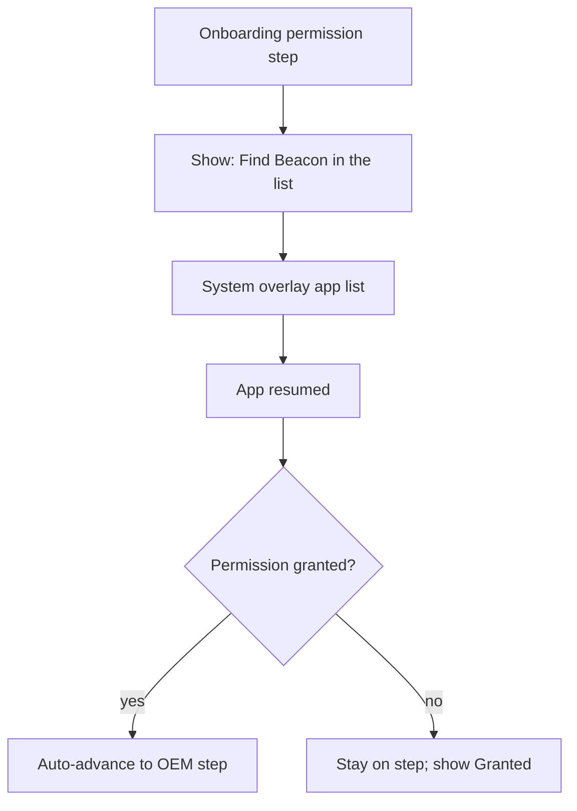

# OEM autostart P0 + overlay onboarding friction

## Reality check (OEM)

This is **not** a missing feature from scratch. Already live:

- Standard Android battery exemption (one-tap) — [lib/status_screen.dart](lib/status_screen.dart), [lib/onboarding_screen.dart](lib/onboarding_screen.dart)
- Vendor instructions including **Vivo** — [lib/oem_autostart_copy.dart](lib/oem_autostart_copy.dart)
- Status ExpansionTiles with full steps; onboarding only lists vendor **names**

OEM Autostart Manager has **no public API**. Instructions-only is correct. Undocumented deep-links are out of scope tonight.

## Overlay permission — what you asked (honest answer)

**Can we highlight Beacon in Android’s “Display over other apps” list?**  
**No — not on Android 11+.** Google’s documented change: `ACTION_MANAGE_OVERLAY_PERMISSION` always opens the **top-level app list** and **ignores** any `package:` URI. Our `minSdk` 29 / `targetSdk` 36 means virtually every closed-test device is in that world. Highlighting a row in system Settings is not an API we control (undocumented hacks are Play/OEM fragile — skip).

**Can we bring the user back into onboarding after they grant?**  
**Yes — and we already mostly do.** [lib/onboarding_screen.dart](lib/onboarding_screen.dart) stays under our activity; Settings is a separate task. On `AppLifecycleState.resumed` while on step 2, `_refreshPermission()` already runs. The user never “left” onboarding in the Flutter sense — they return to the same screen. What’s missing for friction: **auto-advance to the next step** when resume sees `granted == true`, plus clearer pre-flight copy so they can **find Beacon** in the list.

**Opinion:** this *does* reduce friction more than chasing system-list highlight. The real drop-off is “I opened Settings and don’t know which app / what to do next.” Naming the label (**Beacon**) loudly before the jump + celebrating grant with auto-continue is the lever we own.

## Build tonight

### 0. Overlay permission friction (new, from this thread)
In [lib/onboarding_screen.dart](lib/onboarding_screen.dart) `_PermissionStep` / `_requestPermission` / `didChangeAppLifecycleState`:

- Pre-grant copy (use `appDisplayName` from [lib/brand.dart](lib/brand.dart)): e.g. “You’ll see a list of apps — tap **Beacon**, then turn the switch on.” Keep Continue non-blocking (existing calm onboarding rule).
- On resume at step 2: after `_refreshPermission()`, if newly granted → `_next()` once (guard so we don’t re-advance if they navigate back to the step later).
- Optional: brief “Granted” snackbar / status line already exists (“Granted — you’re all set”) before advance.
- Widget test: inject check that flips to true on resume simulation / after request → page advances.
- Same find-hint line on Status permission card (cheap consistency) — no auto-navigate away from Status.

**Not doing:** custom Kotlin to force package-specific overlay settings (broken on API 30+); Restricted Settings coaching beyond what’s already needed for sideload (Play installs skip that cliff).

### 1. Manufacturer matching helper
Add `matchOemGuidance(String manufacturer)` in [lib/oem_autostart_copy.dart](lib/oem_autostart_copy.dart):

- Substring map → Xiaomi/Redmi/POCO, Oppo/Realme/OnePlus, Vivo/iQOO, Samsung
- Pure Dart + unit tests (`vivo`, `xiaomi`, `google`, `Nothing`) — no device needed
- Inject `Future<String?> Function() readManufacturer` into Status/Onboarding for tests
- Prefer **no new dependency** if possible; if we need a real manufacturer read without Kotlin, add `device_info_plus` only after checking [pubspec.yaml](pubspec.yaml). Do **not** edit Kotlin (`CLAUDE.md` §7).

### 2. Status screen
- Resolve matched guidance; put matched tile first; auto-expand; “Looks like your phone” label
- Battery exemption unchanged (verifiable on Nothing)
- Overlay card: Beacon find-hint (see §0)

### 3. Onboarding OEM step
- Show **matched vendor’s full steps** when known; else generic fallback + “revisit in Status”
- Keep battery-exemption CTA

### 4. Home nudge (lightweight)
If battery not exempt and nudge not dismissed → card → Status. Persist dismiss in `AppSettings`. No unlock_log “dead service” heuristics tonight.

### 5. Docs + backlog
- Mark OEM P0 `[DONE]` with friend-verify caveat; note overlay auto-advance
- TEST_PLAN: battery exemption; manufacturer highlight tests; overlay find-hint + auto-advance; friend Vivo soak
- Refresh BACKLOG TOP OF NEXT

## How to test without a Vivo

- Battery exemption + overlay grant/return/auto-advance: **your Nothing Phone**
- Manufacturer highlight: **injected** widget/unit tests
- Nothing match: expect no Vivo/Xiaomi auto-expand
- Real Autostart Manager: **friend** Vivo/iQOO 30–60 min soak checklist

## Explicitly out of scope tonight
- Highlighting our row inside system Settings (Android 11+ forbids package deep-link)
- Undocumented OEM Autostart Intents
- Notification fallback when service is killed
- Kotlin / BootReceiver changes

## Success criteria
- `flutter analyze` + tests green (you run)
- On Nothing: grant overlay → return → onboarding advances; battery + Home nudge look right
- Docs updated; day wraps without Vivo hardware
