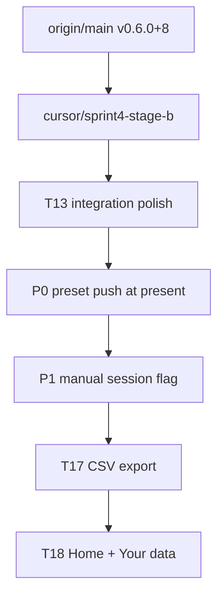

# Sprint 4 post-merge plan (detailed)

**Base:** `origin/main` @ `3a3690a` (v0.6.0+8). T13 is merged and Settings is in Home nav — do **not** re-merge T13.

**Branch:** `cursor/sprint4-stage-b` from a fresh `main` pull.

**Quality bar (every phase):** `flutter analyze` clean; `flutter test` green; for P0/P1 and export, Dinesh on-device confirm before calling done; update `docs/BACKLOG.md` tags when bugs ship; touch `docs/ARCHITECTURE.md` / `CLAUDE.md` only where this plan says (read `docs/DOC_UPKEEP.md` first).



---

## Your T13 doubt — audit result

**Core integration is sound.** Settings is linked; background triage already uses `AppSettings.loadSnapshot()` for prompts / cooldown / probability / quiet hours on every real unlock. Hardcoded `intentCooldown` / `promptProbability` are gone. Quiet hours policy is live. `settings_screen_test.dart` is on main.

**What is wrong / incomplete (must fix in this branch):**

| Gap | Risk | Fix phase |
|-----|------|-----------|
| Home still has **Unlock prompts** `Switch` writing the same key as Settings | Redundant; Home switch **stale** after changing Settings (only loaded in `initState`) | T13 polish |
| Home **Manage options** + Settings **Manage presets** + AppBar **Manage options** | Duplicate nav + inconsistent product name | T13 polish |
| Settings class doc still says “not wired into navigation” | Doc drift | T13 polish |
| `CLAUDE.md` §3 still says hardcoded constants / no settings UI | Misleading for future agents | T13 polish (doc) |

**Does not need rewiring:** Settings → SharedPreferencesAsync → next-unlock `loadSnapshot`. Retention absent from Settings is intentional until T18 Your data.

---

## Phase 0 — Branch hygiene

```text
git fetch origin
git checkout main
git pull --ff-only origin main   # expect 3a3690a or later
git checkout -b cursor/sprint4-stage-b
```

Sanity: open app → Home shows Settings → Settings shows chips/quiet hours → Manage options opens. Do not commit from superseded `cursor/t13-settings-screen*`.

---

## Phase 1 — T13 integration polish (quality / consistency)

**Files:** [`lib/main.dart`](lib/main.dart) (HomeScreen), [`lib/settings_screen.dart`](lib/settings_screen.dart), [`test/widget_test.dart`](test/widget_test.dart), optionally [`test/settings_screen_test.dart`](test/settings_screen_test.dart), [`CLAUDE.md`](CLAUDE.md) §3 / Sprint 4 note (per DOC_UPKEEP: Grep then small edit).

### Steps

1. **Remove Home “Unlock prompts” switch** and `_promptsEnabled` / `_loadPromptsEnabled` / `_togglePrompts` from `HomeScreen`. Single master = Settings “Prompt on unlock”. Keep Settings link prominent.
2. **Unify Manage naming** to **Manage options** (matches AppBar + Home after Claude rename):
   - Settings `ListTile` title: `Manage options` (not `Manage presets`).
   - Update settings widget test string finders.
3. **Nav duplication:** keep **both** Home → Manage options and Settings → Manage options for now (Settings is the natural place; Home is for discoverability). Do **not** remove either unless product says otherwise — only fix the label.
4. Update Settings file doc comment: navigation **is** wired from Home (remove “different task / unwired” wording).
5. **`widget_test.dart`:** drop assertions for Home `Unlock prompts` / that Switch; keep `Settings` link assertion; adjust if layout changed.
6. **CLAUDE.md:** Grep for “hardcoded” / “no settings UI” / “none are wired”; rewrite to: defaults in `AppSettings`, UI in SettingsScreen, triage via `loadSnapshot` each unlock; quiet hours included; Home wires Settings.
7. `flutter analyze` + `flutter test`.

**Done when:** one prompts toggle (Settings only); Manage options wording consistent; docs match code; tests green.

---

## Phase 2 — [P0] Stale overlay `_presets` (corrected approach)

**Read:** `docs/BACKLOG.md` P0 entry, `docs/ARCHITECTURE.md` §1/§3/§5/§8.1.

### Why the old “re-request on unlock” wording was imprecise

The overlay isolate **never sees unlocks**. `_requestPresets()` today runs only in:

- `_OverlayRootState.initState`
- `_OverlayRootState._dismissBubble`

Not on real unlock present, not after Just Like That, not after lock-close. Cached engine keeps stale `_presets` until reboot.

Adding `_requestPresets()` only at end of `_submitNoIntent` is **not enough** (misses: edit presets while overlay closed → next unlock; lock closed capture → edit → next unlock).

### Chosen fix (Option 1, correctly hooked)

**Push active presets from the shared present path** — both real and manual capture shows go through `_presentCaptureOverlay` in the **background** engine:

1. In `_presentCaptureOverlay` (after permission/size gates that already passed in callers), `await _ensureIntentStore()` then call existing `_replyActivePresetsToOverlay(store)` (same payload as `requestPresets` handler).
2. Overlay’s existing `_overlayConfigPortName` listener applies `map['presets']` via `setState` — no new port required for P0.
3. Keep `initState` + `_dismissBubble` `_requestPresets()` retries (startup race + post-bubble hygiene). Optional defense-in-depth: also `_requestPresets()` at end of `_submitNoIntent` — nice-to-have, not sufficient alone.
4. **Do not** implement Manage Options push-invalidation as the sole fix (insufficient; optional later).
5. **Settings are unrelated** — triage already `loadSnapshot()`s every real unlock; config relay is presets-only. No settings refresh needed here.

### Implementation checklist

- [ ] Locate `_presentCaptureOverlay`, `_replyActivePresetsToOverlay`, overlay config listener.
- [ ] Add push + short `debugPrint` (e.g. under 📮/📤 family) so on-device logs show refresh on present.
- [ ] Comment citing BACKLOG P0 + ARCH §8.1.
- [ ] Consider brief empty→pills flash (same as cold start) — acceptable; don’t block paint on await unless trivial.
- [ ] Mark BACKLOG P0 `[DONE date]` after on-device confirm.

### On-device verification (Dinesh)

1. Manage Options: create preset → unlock (no reboot) → new pill visible.
2. Reorder / disable → next unlock reflects order/enabled set.
3. Several “Just Like That” answers → edit presets → next unlock reflects edits.
4. Open capture → lock phone (T12 closes capture) → edit presets → unlock → fresh pills.

### Tests

Hard to fully automate IsolateNameServer. Prefer: extractable unit test for any pure helper; comment + manual matrix in TEST_PLAN if you add a case. Don’t fake a broken green suite.

**Done when:** all four on-device cases pass; BACKLOG updated.

---

## Phase 3 — [P1] Manual Status trigger arms cooldown (corrected approach)

**Read:** `docs/BACKLOG.md` P1 entry, `ARCHITECTURE.md` §8.2.

### Root cause (precise)

- `_showCaptureScreenManually` already skips `_logUnlock`.
- Overlay has **no manual vs real flag** — declare / noIntent / dismiss still relay → `intent_log`.
- `lastCompletedAt()` is `MAX(completed_at)` with **no filter** → next real unlock hits cooldown.

### Chosen fix (Option 2: don’t persist manual answers)

Needs a **new origin flag** (cannot gate in background alone — listener can’t tell origins apart today):

1. When presenting capture, tell overlay whether the session is manual:
   - `_showCaptureScreen` → `manual: false`
   - `_showCaptureScreenManually` → `manual: true`
   - Delivery: piggyback on the P0 present path (e.g. include `manual` in the same overlay config / present message as presets, **or** a tiny dedicated field on a present signal). Prefer **one** present payload `{presets, manual}` to avoid two races.
2. `_OverlayRootState` stores `_sessionIsManual` (default false).
3. In `_submitIntent`, `_submitNoIntent`, `_dismissBubble`: if `_sessionIsManual`, **skip** `_relayDeclaredIntent` / `_relayNoIntent` / `_relayDismissal`; still run UI (bubble / closeOverlay / signals that only clear overlay-active state as required so real unlocks aren’t blocked by `_overlayIsActive`).
4. Clear `_sessionIsManual` when the session ends.
5. Leave Status UX and `_logUnlock` skip unchanged.

**Do not** choose tag-and-filter schema unless you explicitly want manual rows in history/export.

### Overlay-active / lock-signal caution

Manual sessions must still clear “overlay is showing” bookkeeping (`_signalOverlayClosed` / background `_overlayIsActive`) so the next **real** unlock isn’t skipped with `overlay_active`. Skipping DB relays must **not** skip those lifecycle signals.

### On-device verification

1. Status → Show me the prompt now → Just Like That → within cooldown, real unlock still can prompt (probability permitting).
2. Same with declare + bubble × — no cooldown pollution.
3. Confirm no new `intent_log` row from manual answers (adb / History).
4. Real unlock declare still writes history as before.

### Tests

If present payload parsing is pure, unit-test flag application. Widget/integration optional. Mark BACKLOG P1 done after on-device confirm.

**Done when:** manual answers never appear in `intent_log`; real cooldown unaffected by Status taps; real writes still work.

---

## Phase 4 — T17 Single-CSV export (detailed)

**Spec:** `docs/DATA_MODEL.md` §9; plan §8/§9.

### Dependencies

- Add `share_plus` to [`pubspec.yaml`](pubspec.yaml); run `flutter pub get`.
- Prefer path_provider only if temp-file API needs it; `share_plus` XFile from a temp path is enough.

### IntentStore (new APIs)

Open with `ownConnection: true` from UI.

Suggested surface:

```dart
// Pseudocode — match project style
class ExportRow { ... } // or Map with typed helpers
Future<List<ExportRow>> exportRows();
```

SQL behavior:

1. **All unlocks:** `unlock_log` LEFT JOIN `intent_log` ON unlock id (+ LEFT JOIN `intent_preset` for `preset_label`). One row per unlock; outcome columns blank when no intent. If multiple intents per unlock ever exist, follow DATA_MODEL (today expect 0–1); document if join can duplicate.
2. **Then orphans:** `intent_log` WHERE `unlock_id IS NULL` — unlock columns blank.
3. Order: unlocks by `unlocked_at` ascending (or desc — pick one and document); orphans after, by `declared_at`.

### CSV layer — [`lib/export_csv.dart`](lib/export_csv.dart)

- Header exactly:

  `unlocked_at,prompt_shown,skip_reason,intent_text,intent_kind,intent_source,preset_label,preset_id,declared_at,completed_at,duration_seconds,status`

- Timestamps: UTC epoch ms → **ISO-8601 local** (include offset or local wall time consistently).
- `duration_seconds`: `(completed_at - declared_at)` in seconds when both present; empty string when not.
- RFC4180 escaping for commas/quotes/newlines.
- Pure functions unit-tested without Flutter where possible.

### Share + UI

- Write temp file (e.g. `why_did_i_unlock_export_YYYYMMDD.csv`).
- `Share.shareXFiles` — inject `Future<void> Function(String path)` / UrlLauncher-style typedef for tests.
- Settings: **Export data** `ListTile` + one-line subtitle explaining “every unlock, then any orphan intents.” SnackBar on failure.
- Full Your data card still Phase 5 — Export tile can move into that card later without API change.

### Tests ([`test/export_csv_test.dart`](test/export_csv_test.dart), store tests, settings touch)

- Seed unlock-only, unlock+intent, orphan intent → assert column order, local ISO, duration, orphan after unlocks.
- Settings Export invokes injected exporter.
- Use `sqflite_ffi` + `tester.runAsync` for DB.

### Docs

- Mark T17 done in BACKLOG / TEST_PLAN automated table if those tables list it.
- No ARCH change unless export adds ports (it shouldn’t).

**Done when:** analyze/test green; Dinesh can share a CSV that opens in a spreadsheet with expected rows.

---

## Phase 5 — T18 Home insight cards + Your data (detailed)

**Depends on:** Phases 0–4 preferred (Export + polish); hard-depends on T14 (already on main).

### Home card order (plan §5 — “is it working?” before “what did I learn?”)

Implement as a scrollable Home body (extract [`lib/home_screen.dart`](lib/home_screen.dart) if `main.dart` is already huge — **prefer extract** for quality/testability).

| # | Card | Data | Behavior |
|---|------|------|----------|
| 1 | Status | Overlay permission (injectable like StatusScreen) | Short status + link to Status & troubleshooting |
| 2 | Today’s counts | `unlockCount` + `promptShownCount` (`InsightWindow.today`) | Optional 7d/30d segmented control |
| 3 | Breakdown donut | `outcomeBreakdown` → map `OutcomeCategory` → `DonutSlice` (label + color) | Reuse [`lib/insights/outcome_donut.dart`](lib/insights/outcome_donut.dart); empty → painter empty state |
| 4 | Timing | `completionDurationStats` | Median headline, mean secondary; `null` → “Not enough data”; optional one-line caveat: screen-off spans not excluded |
| 5 | Settings summary | `AppSettings` snapshot fields | Compact text + link to Settings |
| 6 | History | — | Existing History link |
| 7 | Empty state | `unlockCount(today)` or all-time == 0 | Honest first-run copy |

**Injection:** `openStore` / `AppSettings` / permission checks for widget tests. `ownConnection: true`. Load in `initState`; handle dispose/close.

**Nav links** remain: Settings, History, Manage options, Status, About (no Unlock prompts switch — Phase 1).

### Your data card (inside Settings)

Per `docs/DATA_MODEL.md` §8 — new section on SettingsScreen (or `lib/your_data_card.dart`):

| Control | Needs |
|---------|--------|
| Events stored | New store helper e.g. `eventCount()` / unlock+intent counts — define clearly in UI copy |
| Oldest record | `oldestUnlockedAt()` or min timestamp across tables |
| Retention | Chips/radio: 90 / 365 / Forever → existing `AppSettings.retentionPeriod` |
| Export | Call Phase 4 exporter |
| Delete all | Confirm dialog → new `deleteAllUserData()` (both logs; presets policy: keep presets unless product says wipe — **default keep presets**, delete unlock/intent only; document) |
| Delete older than… | Confirm → `pruneOlderThan(Duration)` / retention-aligned |

Opportunistic prune on app foreground can wait unless already sketched — Your data one-shot delete is the disclosure requirement.

### Tests

- Home: empty vs seeded fixture (ffi); donut receives three categories; null duration stats.
- Your data: retention round-trip; delete confirm; export invoked.
- Update `widget_test` for new Home content without brittle pixel asserts.

### Docs

- BACKLOG / TEST_PLAN: T18 done notes.
- CLAUDE.md header/status if version bumps (only bump `pubspec` if Dinesh wants a release cut — don’t bump casually mid-branch).

**Done when:** Home tells “is it working?” + today’s story; Settings Your data can export/delete/set retention; analyze/test green; on-device smoke.

---

## Out of scope

- Play brand / privacy hosting / appbundle / minSdk soak (Dinesh).
- Re-implementing T7–T14, battery-exemption Status (done).
- Lock-event table for duration honesty.
- P0 Option 2 push-from-Manage as sole fix.
- P1 schema tag column (unless you override).

## Suggested commit sequence (quality / reviewability)

1. `fix(ui): single prompts toggle in Settings; unify Manage options naming`
2. `fix: refresh overlay presets on every capture present (P0)`
3. `fix: skip intent_log writes for Status manual prompt sessions (P1)`
4. `feat: CSV export via share sheet (T17)`
5. `feat: Home insight cards and Your data card (T18)`

Push only to `cursor/sprint4-stage-b` (or per-commit PR branches), not random T13 leftovers.

## Concerns summary (for Dinesh)

1. T13 **works** for triage; polish the **duplicate Home switch** (stale UI) and **Manage naming** before calling integration “done.”
2. P0 must hook **`_presentCaptureOverlay`**, not only answer handlers — plan corrected.
3. P1 needs an explicit **manual session flag** into the overlay — plan corrected.
4. Prefer shipping P0 → P1 before T17/T18 so closed testing isn’t lying about Manage Options / Status.
5. Your local folder must **`git pull origin main`** before branching — still on superseded T13 tip until you do.
