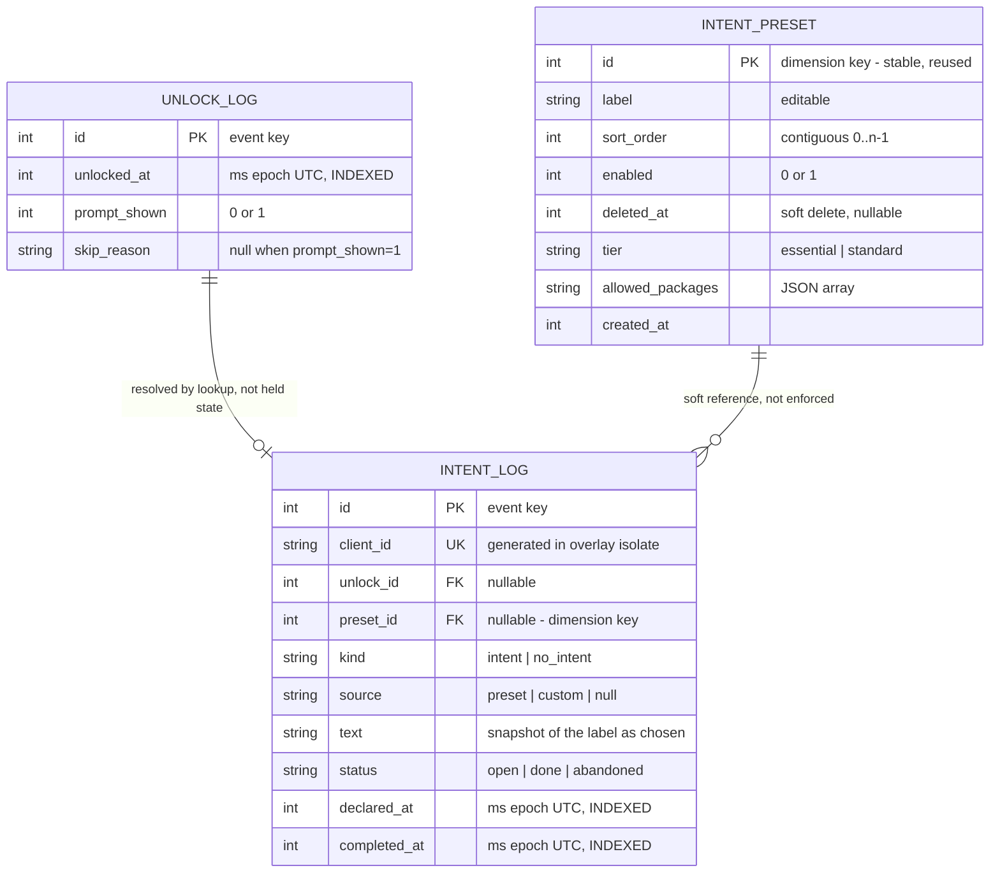

# DATA_MODEL — Why Did I Unlock

> The on-device schema, its invariants, and the reasoning behind them.
> **Read this before changing anything in `lib/intent_store.dart` or any write path
> in `lib/main.dart`.**
>
> For engine topology and plugin gotchas see `docs/ARCHITECTURE.md`; for product
> decisions see `CLAUDE.md`. This file owns the schema — don't restate it elsewhere.

All data is local. There is no server, no sync, and no network call anywhere in the
dependency tree. See `docs/PRIVACY_POLICY.md`.

---

## 1. Entities

Two of these are **fact** tables (one row per occurrence, keys never reused) and one is
a **dimension** (one row per configured thing, referenced many times). That distinction
drives several decisions below.

## 2. Invariants — do not break these

1. **`unlock_log` is append-only.** Written exactly once, at unlock time, never
   updated. Nothing downstream may mutate a row.
2. **`intent_log` is written at declaration and updated once at completion**, keyed on
   `client_id` — a stable, client-generated key. Never correlate by in-memory state.
3. **Logging must never suppress a prompt.** Every store call on the unlock path is
   after the decision, after `showOverlay()`, and its failure is caught and logged only.
4. **The overlay isolate never touches the database.** It has no plugins registered
   (`ARCHITECTURE.md` §1). All reads and writes go through the background isolate.
5. **Read-side screens pass `ownConnection: true`** (`ARCHITECTURE.md` §5) — sharing
   sqflite's default connection lets a screen's `dispose()` close the writer's DB.

## 3. Why two fact tables instead of one

A single table with nullable intent columns reads better (`COUNT(*)`) and fails on the
write path. The unlock is recorded by the background isolate at unlock time; the
outcome arrives from the overlay isolate later. One table means the outcome must
**UPDATE the row the unlock created**, which requires holding correlation state across
an async cross-isolate boundary — the mechanism behind all four Sprint 3 bugs
(`ARCHITECTURE.md` §5). And when correlation is lost, the *entire event* is lost, not
just the association.

Splitting them keeps `unlock_log` append-only and leaves the verified `intent_log`
write path structurally intact.

## 4. Key decisions

### `unlock_id` — resolved by query, never by held state

Because the intent row is written at *declaration* time, the background isolate
resolves the link with a stateless lookup: **the most recent `unlock_log` row with
`prompt_shown=1`.** Unambiguous by construction — while a prompt is showing,
subsequent unlocks are skipped as `overlay_active`, so two prompted unlocks are never
adjacent. Survives process death and holds no state.

Nullable. A null means "unresolvable," never a broken join.

### `status` — declaration-time writes

Rows are created with `status='open'` at declaration and updated to `done` at
dismissal. On background-engine start, any lingering `open` rows are swept to
`abandoned` — a restart means the bubble is gone.

This exists for three reasons: it stops losing intents interrupted by reboot or an OEM
kill (previously discarded entirely); it gives the completed-vs-abandoned distinction
the timing metrics need; and it makes outstanding work queryable (`WHERE status='open'`)
for future multi-intent prompting.

On the declaration write, `completed_at` is set equal to `declared_at` as a
placeholder. This keeps the column NOT NULL (no table rebuild) and is semantically
correct for the cooldown policy — the user has just engaged with the prompt.

**Duration statistics must filter `status='done'`.**

### `preset_id` alongside `text` — both, deliberately

Standard fact/dimension practice: the fact row stores a **snapshot** of the label as
displayed *and* a **key** to the dimension.

- The snapshot keeps history truthful — it records what the user actually saw and chose.
- The key keeps analytics continuous across edits. Rename "Food Order" → "Food" and
  text-grouping splits one series into two unrelated buckets; `preset_id` doesn't.

Null for custom intents and for "Just Like That".

### Preset editing policy

- **Renaming is unrestricted.** Blocking edits to protect analytics is backwards; the
  data serves the user. Fixing a typo must never be friction.
- **History keeps the old label.** `HistoryScreen` renders the stored `text`, never the
  preset's current label. Rewriting past rows would be a falsification.
- **Deletion is soft** (`deleted_at`). A hard delete would orphan the `preset_id`
  references that exist to protect the series.
- **Foreign keys are not enforced.** sqflite leaves `PRAGMA foreign_keys` off by
  default; leaving it off avoids cascade semantics we don't want. A dangling
  `preset_id` degrades to grouping by text, which is simply the older behaviour.

### Getting presets to the capture screen — pull, not push

The overlay isolate renders the capture screen but has no plugins registered, so it
cannot call `IntentStore` directly (`docs/ARCHITECTURE.md` §1). Presets — and `preset_id`
by extension — reach it via a same-process relay, not a hardcoded list:

1. The overlay isolate sends `{'type': 'requestPresets'}` over the existing
   overlay→background write port (no second overlay→background port needed).
2. The background isolate calls `activePresets()` (already filtered to
   enabled+non-deleted, already ordered) and replies with just `{id, label}` per
   preset — the overlay never needs `sort_order`/`tier`/`allowedPackages`, those are
   fully resolved before the reply is built.
3. The reply lands on a port the overlay isolate registers itself, the first time
   this codebase has a port registered from that side rather than only looked up.

**Pull, not push, deliberately:** a push right after `showOverlay()` would race the
overlay engine's cold start on the very first show, since the overlay's reply port
can't exist to receive anything before its own isolate has run far enough to register
it. Making the late party (the overlay) the requester removes the race outright.

**Requested on every return to capture mode, not just once at engine cold start** —
the overlay engine is cached and can live for the app process's whole lifetime, so a
preset edited via the (separate) main-engine Settings/manage-presets screens would
otherwise stay stale for that cached engine's entire remaining life. Re-requesting on
every dismissal keeps it acceptably fresh without needing the background engine to
push updates proactively.

**An empty preset list is not a loading state to special-case** — it's the same
already-tested "zero enabled presets" state from the Limits section above, reused
for the brief window between engine cold start and the first reply landing. No
spinner, no flash of stale data: the capture screen (text field + "Just Like That")
is always valid regardless of whether presets have arrived yet.

## 5. `skip_reason` values

| Value | Fires when | Expected volume |
|---|---|---|
| `prompts_disabled` | master toggle off | common if used |
| `cooldown` | within the cooldown of the last event | very common |
| `probability` | random gate missed | very common |
| `overlay_active` | a capture screen or bubble is already showing | common |
| `no_permission` | overlay permission missing or revoked | rare — and the highest-value row here, because it is silent breakage becoming visible |
| `invalid_screen_size` | native `getRealMetrics` returned 0×0, or channel args malformed | ~never |
| `plugin_timeout` | `_withTimeout` fired — a plugin native call didn't return in 5s | ~never |
| `quiet_hours` | current time falls inside the user's configured quiet-hours window | common if the user sets a window — see §11 |

The last two are **defensive guards, not expected paths.** They exist because this
codebase has been bitten by a native call that never returned
(`FlutterOverlayWindow.isActive()`, `ARCHITECTURE.md` §5), which is why `_withTimeout`
exists at all. Keep them distinct: a nonzero count is a loud signal that something is
wrong at the platform layer.

## 6. What is and isn't captured

| Scenario | `unlock_log` | `intent_log` |
|---|---|---|
| Triage skips (cooldown / probability / disabled) | `prompt_shown=0` + reason | none |
| Permission missing or revoked | `prompt_shown=0`, `no_permission` | none |
| Declared, dismissed | `prompt_shown=1` | `done` |
| "Just Like That" | `prompt_shown=1` | `no_intent`, `done` |
| Prompt shown, locked or powered off unanswered | `prompt_shown=1` | none |
| Declared, restart or OEM kill before dismissing | `prompt_shown=1` | `open` → `abandoned` |
| Relay fails at dismissal | `prompt_shown=1` | stays `open` → `abandoned` |
| Bubble live, phone locked and unlocked again | `prompt_shown=0`, `overlay_active` | none |
| Screen wakes without unlocking | no row | none |
| **Service dead (force-stop / OEM kill)** | **no rows** | none |

### The one honest caveat

When the foreground service is dead, unlocks are not observed and therefore not
logged. **"Unlocks today" is a floor, not a truth** — and it undercounts most in
exactly the OEM-kill scenario this app is most vulnerable to. Label the metric so it
doesn't over-promise; the status card is the real defence. Gap detection via a
`service_log` table is backlogged, not built.

## 7. Limits

The binding constraint on presets is **decision cost, not screen space.** The capture
screen must be answerable in about two seconds, one-handed, at unlock. More pills means
slower decisions, and a prompt that is slow to answer gets answered dishonestly or not
at all. Scrolling to find a preset at unlock is a failure state.

| Limit | Value | Enforced |
|---|---|---|
| Enabled presets | 8 (5–6 recommended) | app level |
| Stored presets incl. disabled | 30 | app level |
| Preset label | 24 chars UI / 40 stored | UI + store |
| `allowed_packages` | 2000 chars | **not yet enforced** — reserved; no setter exists until app-restricted sessions land (§10) |
| Custom intent text | 100 chars UI / 500 stored | existing, unchanged |

Enforced in app code, not as DB constraints — a row-count limit needs a trigger in
SQLite, and app-level checks return usable errors.

**The minimum is zero, deliberately.** A user who prefers typing every intent may
disable all presets; the capture screen stays valid (text field + "Just Like That").
The safety net is a **restore-defaults** action, not a forced minimum.

`sort_order` is rewritten contiguous on reorder. Only *enabled, non-deleted* presets
are relayed to the overlay isolate.

## 8. Retention

**Default 365 days.** Options: 90 / 365 / Forever. Pruned opportunistically on app
foreground, throttled to at most weekly — no background job. Because the app is rarely
opened, data may outlive the nominal window; that is harmless.

`Forever` remains available because the longitudinal view is this product's payoff — a
hard cap makes year-over-year comparison permanently impossible.

Sizing at 100 unlocks/day: `unlock_log` ≈ 70 bytes/row (~2.5 MB/year), `intent_log`
≈ 150 bytes/row at ~25/day (~1.4 MB/year). Storage is a non-issue at every setting.

**Latency is decoupled from retention by design:** every dashboard query is windowed
(today / 7d / 30d) and index-backed, never a full-table scan. Median is computed in SQL
(`COUNT`, then `ORDER BY … LIMIT 1 OFFSET n/2`) rather than by pulling rows across the
platform channel.

**Do not `VACUUM`** after a prune — it rewrites the entire database to reclaim a few
MB; free pages are reused.

Retention is surfaced, not silent: a "Your data" card in Settings shows events stored,
oldest record, current setting, export and delete-all, plus a one-shot "delete data
older than…" so control never means waiting for a prune.

## 9. Export

**A single lossless CSV**, shared via the system share sheet. One row per unlock, with
outcome columns filled where there was one — then **any orphan intents appended** with
the unlock columns blank, so nothing is ever dropped.

Columns: `unlocked_at, prompt_shown, skip_reason, intent_text, intent_kind,
intent_source, preset_label, preset_id, declared_at, completed_at, duration_seconds,
status`.

Timestamps are **ISO-8601 local**, not epoch milliseconds, so spreadsheets parse them
natively; `duration_seconds` is precomputed. Headers are self-documenting, so no
separate README file ships — a one-line explanation lives on the export screen.

## 10. Forward compatibility

Columns present but unused, so the features below need **no further migration**:

| Column | Reserved for |
|---|---|
| `intent_preset.tier` | Delay-to-reveal prompts — essentials instantly, the rest after a few seconds |
| `intent_preset.allowed_packages` | App-restricted sessions (`UsageStatsManager`), sequenced after first Play approval |
| `intent_log.status = 'open'` | Multi-intent prompting — showing outstanding work on a later unlock |

`overlay_active` is retained as a distinct `skip_reason` value even though multi-intent
will eventually stop producing it. Old rows stay interpretable: they simply cease to
appear, and analysis buckets by date. No backfill, no migration, no row ever becomes
retroactively wrong.

## 11. Quiet hours

Added to this iteration's scope after the initial plan: a user-configured time-of-day
window (e.g. 11pm–7am) during which prompts are suppressed entirely, independent of
cooldown/probability. Cheap to add — no new permission, no native code, no schema
migration beyond the `skip_reason` value above (a TEXT column, not a SQL enum, so this
needed no `ALTER TABLE`).

Implemented as `QuietHoursPolicy implements PromptPolicy` in `lib/prompt_policy.dart`
(T3/T9 scope), joined into the same composite check as cooldown and probability — the
class was already built for exactly this ("a new triage strategy is a new list
element, never a change to the call site"). The window is stored via
`app_settings.dart` and surfaced in the Settings screen (T13) alongside cooldown and
probability.

**One implementation detail that matters:** the window can wrap past midnight (e.g.
23:00–07:00), so the comparison must treat `start > end` as "outside the window is the
short segment between end and start," not a naive `start <= now <= end` range check —
that naive form is correct for a same-day window and silently backwards for an
overnight one.

## 12. Schema versions

| Version | Change |
|---|---|
| 1 | `intent_log` only (Sprint 3) |
| 2 | `unlock_log`; `intent_log` + `status`, `unlock_id`, `preset_id`; `idx_declared_at`; `intent_preset` + seed. All additive. |

Planned: v3 adds `intent_log.timer_duration_ms` with the timer feature.

**A clean `flutter test` does not prove a schema change works on-device.** The
`PRAGMA journal_mode=WAL` bug (`ARCHITECTURE.md` §5) passed every desktop test and
failed on a real phone. Every migration needs at least one real-device upgrade-install
write/read cycle.
