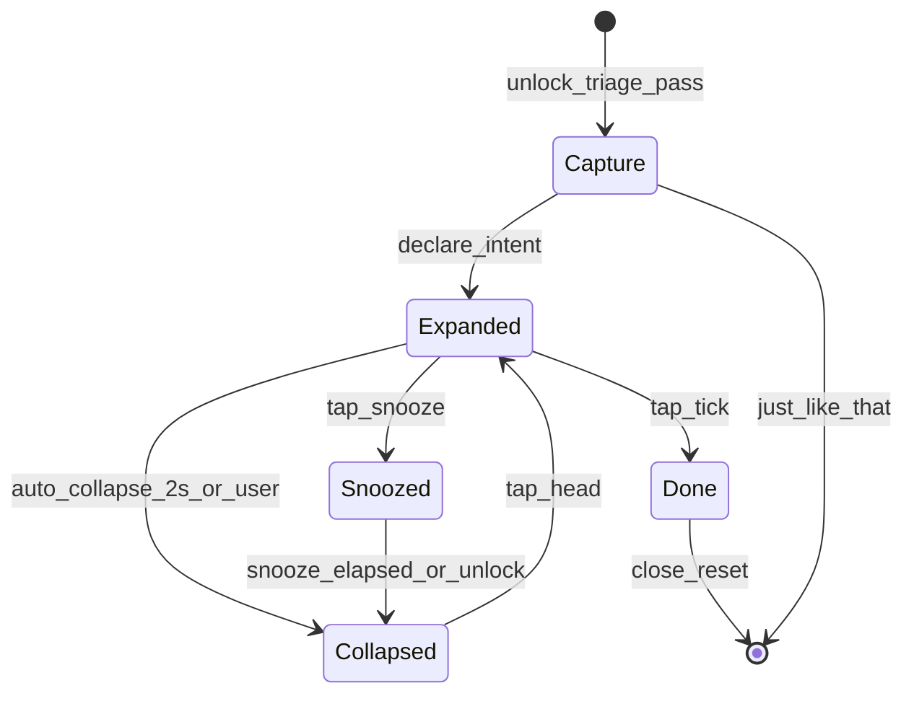
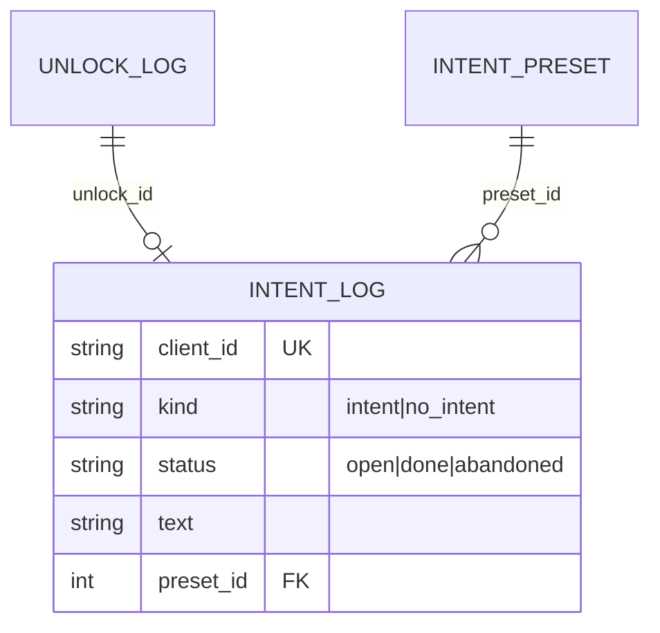

<!--
ARCHIVED PLANNING DOCUMENT — signed off 2026-07-24.

Bubble UX hybrid (less-intrusive session bubble): confirm-then-collapse (1C),
Done tick + Snooze temporary hide (2A, unlock ends snooze early). Visual tokens
from Stitch Prompt 1+4. Implementation: `lib/bubble_widget.dart`,
`lib/bubble_icons.dart`, overlay/background wiring in `lib/main.dart`.

For current schema see docs/DATA_MODEL.md. Task status: git log / BACKLOG.md.

## Update log

- **2026-07-24 (Beacon):** §I.5 locked to amber `#FFB300` + frosted glass; app-wide
  theme via `lib/beacon_theme.dart`. Durable token copy also at
  `docs/erd/beacon-visual-identity-2026-07-24.md`.
- **2026-07-24 (rotation/snap):** expand/collapse = close+reopen (not resize alone);
  snap uses native display size; overlay `didChangeMetrics` rotation path removed.
  Native: `ScreenMetrics.kt` + `onOrientationChanged`.
- **2026-07-24 (sign-off):** plan approved and archived here; implementation lands
  on the same branch.
-->

# Bubble UX — less intrusive session bubble

**Structure:** Part I = product PRD · Part II = ERD / state · Part III = build plan · Appendix = design prompts.

---

## Locked decisions (2026-07-24)

| # | Choice | Meaning |
|---|---|---|
| **1C** | Confirm-then-collapse hybrid | After declare → **Expanded** → after about **2s idle** → **Collapsed** (~52dp icon). Tap icon to expand again. |
| **2A** | Snooze = temporary hide | Hide bubble while unlocked; intent stays `open`. **Unlock ends snooze early**. Timer expiry also restores Collapsed. |
| Done | Tick (not ×) | Completes intent → existing `status='done'`. |
| Fallback | **1A only if 1C breaks** | If auto-collapse resize is flaky on-device, ship icon-first declare without dropping Done/Snooze. |

Friend feedback: the fixed **200×56dp** always-on pill is too intrusive.

---

# Part I — Product PRD

## I.1 Problem

The bubble is the product wedge (`CLAUDE.md` §10), but Sprint 2’s always-visible text pill + single × covers content and makes completion look like cancel. Three backlog items are one problem: adaptive sizing, smaller footprint + richer actions, icon + tap-to-expand.

## I.2 Goals / non-goals

**Goals:** always-visible footprint ≈ 48–56dp after brief confirm expand; text on declare + on tap; Done vs Snooze; no continuous animation; no schema change for v1.

**Non-goals:** timer ring; per-preset icon picker UI; multi-intent; Kotlin; Snooze-as-abandon.

## I.3 Requirements

| ID | Requirement |
|---|---|
| R1 | On declare, show Expanded (icon + truncated intent + Done + Snooze). |
| R2 | After ~2.0s idle, collapse to icon-only chat head. |
| R3 | Tap collapsed → Expanded; tap icon again → Collapsed. |
| R4 | Done (tick) → `status='done'`, close overlay. |
| R5 | Snooze hides overlay for **10 minutes** while unlocked; intent stays `open`. |
| R5b | **Any unlock while snoozed ends snooze** and re-shows Collapsed. |
| R6 | Adaptive expanded width up to 240dp; keep `intentMaxInputLength = 100`. |
| R7 | Seed presets get distinct icons; custom → letter avatar. |
| R8 | Just Like That unchanged. |
| R9 | Touches outside the small window pass through. |
| R10 | Semantics expose full intent text when collapsed/expanded. |
| R11 | Rotation/size: keep bubble reachable (clamp / edge-reanchor). |

## I.4 Interaction model

Snooze on **Expanded** only. Unlock cancels snooze early (agreed). Process death while snoozed → existing `abandoned` sweep.

## I.5 Visual spec (Beacon frosted glass)

| Element | Spec |
|---|---|
| Fill | Black @ 60% (`#99000000`) + `BackdropFilter` σ≈10 |
| Edge | Amber glow `#FFB300`, 1.5dp stroke + soft amber shadow |
| Glyphs | Pure white |
| Expanded | 52dp tall, max 240dp wide, stadium |
| Collapsed | 52×52dp circle |
| Done | White badge + dark check |
| Snooze | White@18% circle + white `notifications_paused` |
| Order | `[icon] [text…] [Snooze] [Done]` |
| App accent | Same `#FFB300` via `lib/beacon_theme.dart` (switches, FAB, Done chart slice, prompt pill borders) |

Edge dock: `PositionGravity.none` + snap helpers; half-peek later if plugin allows.

---

# Part II — ERD / state

**Schema change for v1: none.** Snooze is UI-only. Unlock-while-snoozed may log `unlock_log.skip_reason = snooze_ended` (no `intent_log` write).

| User action | DB |
|---|---|
| Declare | `status='open'` |
| Done | `status='done'` |
| Snooze / snooze ends | none on `intent_log` |
| Process death while open/snoozed | sweep → `abandoned` |

**Forward-compat:** `intent_preset.icon_key`; optional `snooze_count` / snooze events later.

---

# Part III — Build notes

- `showOverlay` = device px; `resizeOverlay` = dp.
- Capture→bubble: close+reopen (focus). Collapsed↔expanded: try `resizeOverlay`, else close+reopen.
- Snooze: overlay signals background `snoozeStart`; background owns 10-min timer + unlock restore via collapsed `showOverlay`.
- Files: `lib/bubble_widget.dart`, `lib/bubble_icons.dart`, `lib/bubble_overlay_geometry.dart`,
  `lib/beacon_theme.dart`, `lib/main.dart`; native `ScreenMetrics.kt` +
  `UnlockListenerService.onConfigurationChanged`.
- Visual tokens: `docs/erd/beacon-visual-identity-2026-07-24.md` (Beacon amber / glass).

## Limitations

- Process death during snooze → `abandoned` (same as live bubble death).
- Half-peek edge hide deferred if move/resize positioning is unreliable.

---

# Appendix — Stitch prompts

Prompt 1 (states) + Prompt 4 (before/after) accepted. Prompt 2 flow-only. Prompt 3 skipped (illegible) — Material icons in code.
