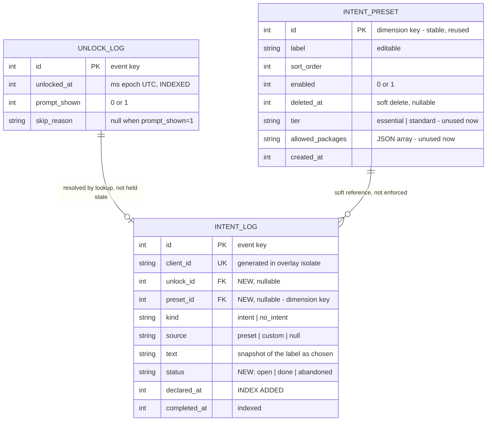
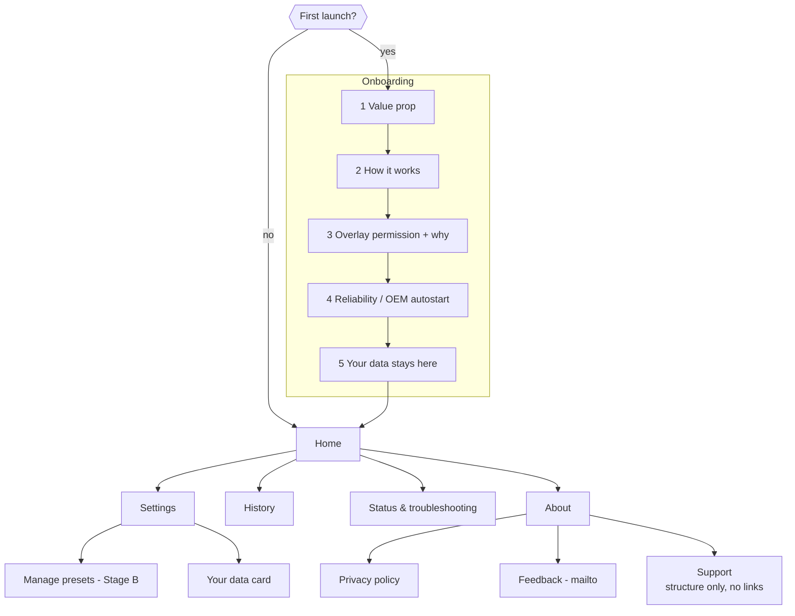
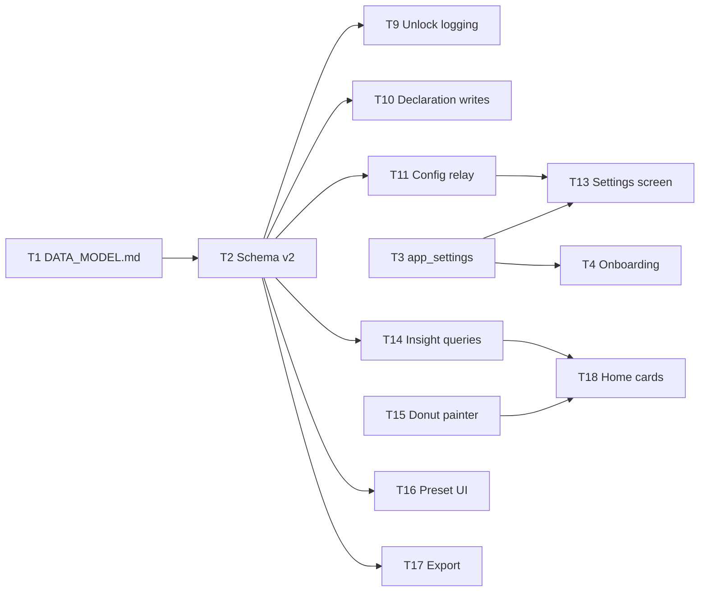

<!--
ARCHIVED PLANNING DOCUMENT — signed off 2026-07-23.

This is the full Sprint 4 plan as approved (via Claude Code's plan-mode
ExitPlanMode), copied verbatim from the local plan file it originated in
(~/.claude/plans/add-these-and-other-kind-gray.md — a machine-local Claude Code
artifact, not synced or durable, which is why a copy now lives here instead).
It covers the information architecture, the full data model rationale, the
screen map, and the Claude Code / Cursor task breakdown for Sprint 4.

This file MAY be updated as implementation proceeds or scope changes — see the
"Update log" below for what's changed since sign-off and why. Edit the body
when something here goes stale; add a dated log entry rather than silently
rewriting history. For current, up-to-date information see:
  - Schema, invariants, and the ERD as currently implemented: docs/DATA_MODEL.md
  - Task status: ask in-session, or check git log on this branch
    (sprint4-app-shell) against the task list below.
  - Play Store submission prep: docs/PLAY_SUBMISSION.md
  - Privacy policy: docs/PRIVACY_POLICY.md

## Update log

- **2026-07-24 (Stage B wrap):** T17/T18 + Home nav wiring landed on
  `cursor/sprint4-stage-b`. Same branch also shipped bubble UX hybrid + Beacon visual
  identity + native orientation reopen (`ScreenMetrics`) — see
  `docs/erd/bubble-ux-hybrid-plan-2026-07-24.md` and
  `docs/erd/beacon-visual-identity-2026-07-24.md`. Version bump `0.6.1+9`. Remaining
  work is on-device verify (`docs/BACKLOG.md` TOP OF NEXT THREAD), not more Stage B
  feature scope.
- **2026-07-24 (copy):** §6 metric card label → **"Time to mark done"** (was informal
  "Time to complete a task"); Settings quiet-hours switch → **"Suppress prompts"**
  (dropped "overnight" — section header already says Quiet hours).
- **2026-07-23 (sign-off):** initial plan approved as written below.
- **2026-07-23 (later same day):** time-based "quiet hours" scheduling (a prompt
  suppression window, e.g. 23:00-07:00) added to scope during implementation. Not
  reflected as its own line in the §10 task table — folded into T3 (settings
  storage), T9 (triage policy), and T13 (Settings screen exposure). Design in
  `docs/DATA_MODEL.md` §11.
- **2026-07-23 (Cursor UI tasks):** T4/T5/T6/T15/T16 landed —
  `lib/onboarding_screen.dart`, `lib/about_screen.dart`, `lib/status_screen.dart`
  (+ shared `lib/oem_autostart_copy.dart`), `lib/insights/outcome_donut.dart`, and
  `lib/manage_presets_screen.dart`, each with widget tests (see `docs/TEST_PLAN.md`'s
  automated-tests table). All five are self-contained screens built against the
  already-shipped `AppSettings`/`IntentStore`/`triggerCapturePromptManually` APIs —
  **none are wired into `MyApp`/`HomeScreen` navigation yet**, so none have a manual
  on-device matrix entry either; that wiring is T18's job. `url_launcher` added as a
  new dependency (T5's mailto/privacy/Play links only — no network call by the app
  itself). Contact email, privacy-policy URL, and Play-listing URL are all
  grep-able `TODO_*_UNRESOLVED` placeholders pending the real `[P1]` decisions in
  `docs/BACKLOG.md`.
-->

# Sprint 4 — App shell: onboarding, IA, and a data model built to outlast it

## Context

The app has one real screen (`HomeScreen`: a title, one toggle, one link) plus a
minimal read-only `HistoryScreen`. Everything else is background machinery. Fine for
sideloading to friends; not fine for a Play listing and a 20-person closed test, where
first run *is* the product and nobody is there to explain the permission cliff.

This plan covers the information architecture and the data model. The model is shaped
to absorb three features **not** built now (multi-intent stacking, user-defined
presets, tiered prompts with app-restricted sessions), because retrofitting schema
later means another migration plus rework of a verified write path.

Already decided: payment links deferred past first Play approval · feedback via
`mailto:` · insights Home ships **during** the closed test · telemetry stays deferred.

---

## 1. Why the current table can't answer "unlocks today"

`intent_log` records **completed interactions only** — a row appears when the user
dismisses a bubble (`_dismissBubble`) or taps "Just Like That" (`_submitNoIntent`).
Nothing is written when prompts are off, cooldown or probability skips, the overlay is
already showing, permission is missing, or an intent is declared but never dismissed.

At the shipped defaults (1-min cooldown ANDed with 50% probability) **well under half
of unlocks produce a row** — biased toward flattering the user, the worst possible
direction for this product.

## 2. Data model

### 2.1 Two event tables, not one

A single table with nullable intent fields reads better (`COUNT(*)`) and fails on the
**write path**: the unlock is recorded by the background isolate at unlock time; the
outcome arrives from the overlay later. One table means the outcome must **UPDATE the
row the unlock created**, requiring in-memory correlation across an async
cross-isolate boundary — the mechanism behind all four Sprint 3 bugs
(`ARCHITECTURE.md` §5). Worse, losing correlation loses the *entire event*.

`unlock_log` is therefore **strictly append-only: written once, at unlock time, never
updated.**

### 2.2 `unlock_id` — the link, resolved statelessly

An earlier draft dropped this because no dashboard metric needs a join. True, and
beside the point: **export exists for the questions nobody anticipated.**

The original objection was to in-memory correlation, and §2.3 removes it. Because the
intent row is written at *declaration* time, the background isolate resolves the link
with a **stateless SQL lookup** — the most recent `unlock_log` row with
`prompt_shown=1`. Unambiguous by construction: while a prompt is showing, subsequent
unlocks are skipped as `overlay_active`, so two prompted unlocks are never adjacent.
Survives process death, holds no state, one indexed query on a rare path. Nullable —
a null means "unresolvable," never a broken join.

### 2.3 `status` — one column, three problems solved

**Write the intent row at declaration with `status='open'`; update to `done` at
dismissal**, keyed on the `client_id` the overlay already generates. Idempotent,
order-independent — not the fragile update rejected in §2.1.

1. **Stops losing data.** An intent declared then interrupted by reboot or OEM kill
   currently vanishes (§3 cases 7, 8). Now it survives as `open`, swept to `abandoned`
   on next background-engine start.
2. **Gives completed-vs-abandoned**, which the `[P2]` backlog item wanted and the
   timing metric (§6) needs.
3. **Is the hook for multi-intent** (§7.1): outstanding work is `WHERE status='open'`.

Additive migration. On the declaration write set `completed_at = declared_at` as a
placeholder — keeps the column NOT NULL (no table rebuild) and is semantically right
for cooldown, since the user just engaged. Duration stats filter `status='done'`.

### 2.4 `preset_id` — you were right, and it's free

`intent_preset.id` is a **different kind of key** from the other two: `unlock_log.id`
and `intent_log.id` are *event* keys (one per occurrence, never reused);
`intent_preset.id` is a *dimension* key (one per configured thing, referenced many
times). That distinction is exactly why carrying it into `intent_log` is worth doing.

**Store both the id and the text.** This is standard fact/dimension practice: the
snapshot preserves what the user actually saw and chose; the key preserves the series
across edits. Concretely — rename "Food Order" → "Food" and text-grouping splits your
history into two unrelated buckets, while `preset_id` keeps one continuous series.

Cost: one nullable INTEGER column, on a schema being created anyway. Null for custom
intents and "Just Like That". **This supersedes the `[P2] preset_id` backlog item —
do it now rather than migrate for it later.**

### 2.5 Renaming and deleting presets — the resolved policy

Your instinct was right that there's a tension, and it dissolves once `preset_id`
exists. Best practice, and what we'll do:

- **Renaming is unrestricted.** Blocking edits to protect analytics is backwards — the
  data serves the user, not the reverse. Fixing a typo must never be friction.
- **History keeps the old label.** That row is a factual record of what the user chose
  at that moment; retroactively rewriting it would be a lie. `HistoryScreen` always
  renders the stored `text`, never the preset's current label.
- **Deletion is soft** (`deleted_at` set, hidden from the capture screen). Hard
  deletion would orphan `preset_id` references and break the series it exists to
  protect. Soft-deleted presets can still appear in historical breakdowns, greyed.
- **The FK is a soft reference, not enforced.** sqflite leaves `PRAGMA foreign_keys`
  off by default; leaving it off avoids cascade semantics we don't want, and a
  dangling id degrades to "group by text," which is exactly the old behaviour.

Net: users edit freely, analytics stay continuous, history stays truthful.

### 2.6 Migration

`_schemaVersion` 1 → 2, adding the first-ever `onUpgrade`: `CREATE TABLE unlock_log` +
index · `ALTER TABLE intent_log ADD COLUMN status`, `ADD COLUMN unlock_id`,
`ADD COLUMN preset_id` · `CREATE INDEX idx_declared_at` · `CREATE TABLE intent_preset`
+ seed the current five. All additive. Timer column becomes v3.

### 2.7 Preset limits — UI and table level

**The binding constraint is decision cost, not screen space.** The capture screen's
`Wrap` already scrolls gracefully (the thumb-zone layout uses `LayoutBuilder` +
`ConstrainedBox` + `IntrinsicHeight`), so ~12–15 pills would *fit* on a typical
360dp-wide phone at 2–3 per row. That's the wrong limit to design to.

This screen has to be answerable in about two seconds, at unlock, one-handed. Decision
time grows with the number of options, so every extra pill makes the prompt slower to
answer — and a prompt that's slow to answer gets answered dishonestly ("Just Like
That" as an escape) or not at all. Scrolling to find a preset at unlock is a failure
state, not a feature. It also compounds the muscle-memory problem already noted in the
`[explore] randomize preset order` backlog item.

| Limit | Value | Where enforced | Why |
|---|---|---|---|
| **Enabled presets** | **max 8**, 5–6 recommended | app level, in `setEnabled`/`createPreset` | Decision cost. 8 fits ~3 rows without scrolling on a small phone. |
| Stored presets (incl. disabled) | 30 | app level | Keeps the management list and relay payload sane. Users curate a library and toggle. |
| Label length | 24 chars UI / 40 stored | `TextField maxLength` + store-side check | The bubble truncates around 25–30 chars at 200dp/14sp; a label longer than its own pill is useless. Store cap is defence-in-depth, mirroring `_maxStoredTextLength` in `intent_store.dart`. |
| `allowed_packages` | 2000 chars | store-side check | Unused now; a bound costs nothing. |

**Enforced in app code, not as DB constraints** — a row-count limit isn't expressible
in SQLite without a trigger, and app-level checks give a usable error message.

**Minimum is zero, deliberately.** A user who prefers typing every intent should be
allowed to disable them all; the capture screen stays valid (text field + "Just Like
That"), and the layout must be verified in that state. The safety net for someone who
disables everything by accident is a **"restore defaults"** action in the
manage-presets screen, not a forced minimum.

`sort_order` is rewritten contiguous (0…n−1) on reorder — with ≤30 rows that's
trivial and far easier to reason about than gap-based ordering.

**Relay payload:** only *enabled, non-deleted* presets are sent to the overlay isolate.
At 8 × ~50 bytes that's negligible; the overlay never needs the full library.

## 3. Interruption and edge cases

"UL" = `unlock_log`, "IL" = `intent_log`. ✨ = changed by §2.3.

| # | Scenario | UL | IL | Notes |
|---|---|---|---|---|
| 1 | Triage skips | `prompt_shown=0` + reason | none | ✅ |
| 2 | Permission missing/revoked | `prompt_shown=0`, `no_permission` | none | ✅ surfaces silent breakage |
| 3 | Declared, dismissed | `prompt_shown=1` | `done` | ✅ |
| 4 | "Just Like That" | `prompt_shown=1` | `no_intent`, `done` | ✅ |
| 5 | Prompt shown, locked unanswered | `prompt_shown=1` | none | §3a |
| 6 | Prompt shown, power off unanswered | `prompt_shown=1` | none | ✅ UL written eagerly |
| 7 ✨ | **Declared, restart before dismiss** | `prompt_shown=1` | `open` → `abandoned` | was total loss |
| 8 ✨ | Declared, OEM kill | `prompt_shown=1` | `open` → `abandoned` | same recovery |
| 9 | Bubble up, lock, unlock again | `prompt_shown=0`, `overlay_active` | none | current behaviour, kept — §7.1 |
| 10 | Rapid lock/unlock | one row each, mostly `cooldown` | none | ✅ the compulsive-checking signal |
| 11 | Screen wakes without unlock | no row | none | ✅ `ACTION_USER_PRESENT` doesn't fire |
| 12 | Swipe-to-unlock | normal | normal | ✅ |
| 13 | First unlock after reboot | normal | normal | ✅ `USER_PRESENT` is post-unlock, CE storage up |
| 14 ✨ | Relay fails at dismissal | `prompt_shown=1` | stays `open` → `abandoned` | declaration persisted |
| 15 | **Service dead during unlocks** | **no rows** | none | ❌ invisible undercount, §3b |
| 16 | DB unavailable at unlock | no row | n/a | must never suppress the prompt, §3c |

### 3a. Screen-off behaviour — precisely

- **Capture mode** (unanswered question on screen) → **close it.** A stale question
  from a previous session is noise, and leaving it open makes the next unlock log as
  `overlay_active` — polluting skip stats with a non-skip.
- **Bubble mode** (intent outstanding) → **leave it live.**

**This iteration the next unlock with a live bubble still skips**, exactly as today.
See §7.1 for what changes later and why it won't break.

### 3b. Case 15 — the honest caveat

When the foreground service is dead, unlocks aren't observed. **"Unlocks today" is a
floor, not a truth**, undercounting most in exactly the OEM-kill scenario. Label it
accordingly; the status card is the real defence. `service_log` gap detection →
backlog.

### 3c. Case 16 — logging must never break the product

The `unlock_log` insert runs **after** the decision and **after** `showOverlay()`,
failures caught and logged only. Keeps it off the ~500ms unlock path (`CLAUDE.md` §8)
and guarantees a storage fault can't suppress a prompt.

### 3d. The seven `skip_reason` values, and when each actually fires

| Value | When | Expected volume |
|---|---|---|
| `prompts_disabled` | master toggle off | common if used |
| `cooldown` | within `intentCooldown` of last event | very common |
| `probability` | random gate missed | very common |
| `overlay_active` | a capture screen or bubble is already showing | common |
| `no_permission` | overlay permission missing or revoked | rare, but the highest-value row in the table — this is silent breakage becoming visible |
| `invalid_screen_size` | native `getRealMetrics` returned 0×0, or the channel args were malformed | **~never** |
| `plugin_timeout` | `_withTimeout` fired — a plugin native call didn't return in 5s | **~never** |

The last two are **defensive guards, not expected paths.** They exist because this
codebase has already been bitten by a native call that never returned
(`FlutterOverlayWindow.isActive()`, `ARCHITECTURE.md` §5), which is why `_withTimeout`
exists at all. Keep them as distinct values precisely because a nonzero count is a
loud signal that something is wrong at the platform layer — a diagnostic that costs
nothing to carry.

## 4. Retention — 365 days, disclosed, adjustable

**Default 365 days. Options 90 / 365 / Forever.** Pruned opportunistically on app
foreground, throttled to at most weekly — no background job, no new native surface.
Since the app is rarely opened, data may live somewhat past the nominal window; that's
harmless.

An earlier draft proposed redacting intent text at 30 days. Dropped: local data is
already protected by device encryption at rest, and anyone holding your *unlocked*
phone can open the app and read recent history anyway — so redacting month-old text
protects against almost nothing, while costing a redaction path, sentinel handling,
"(text expired)" states, export complexity, and confusion. It also destroys the most
useful thing for self-analysis: the words themselves.

**The real requirement was disclosure, not a shorter window:**
- **A "Your data" card in Settings** — events stored, oldest record date, current
  retention, export, delete-all. Also a nice ownership moment ("1,247 unlocks since
  12 Aug 2026").
- **One onboarding line** on data staying local and how to delete it.
- **A one-shot "delete data older than…"**, so control never means waiting for a prune.

`Forever` stays available: the longitudinal story is this product's payoff.

**Sizing, checked:** at 100 unlocks/day, `unlock_log` ≈ 70 bytes/row (2.5 MB/year) and
`intent_log` ≈ 150 bytes/row at ~25/day (1.4 MB/year). Non-issue at every setting.
**Latency is decoupled from retention by design** — every dashboard query is windowed
(today / 7d / 30d) and index-backed, never full-table. Median in SQL (`COUNT` then
`ORDER BY … LIMIT 1 OFFSET n/2`). **Do not `VACUUM`** after a prune; free pages get
reused.

## 5. Screen map

Flat hierarchy, card-based Home, drill-downs. **No bottom navigation** — four
destinations don't justify persistent chrome on a rarely-opened app.

**Onboarding**: value prop → how it works → **overlay permission explained before the
system dialog** (today `_HomeScreenState.initState` fires `requestPermission()` cold —
the drop-off `CLAUDE.md` §9 warns about) → OEM autostart walkthrough with a "my phone
isn't listed" skip (`[P1]`; a killed service breaks the continuously-opted-in count) →
data disclosure. Notification step only if the Android 13+ check in
`docs/PLAY_SUBMISSION.md` §3 shows it's needed.

**Home**, priority order — "is it working?" before "what did I learn?": status card ·
today's counts · breakdown donut · timing (median headline) · settings summary · full
history · empty state.

**Settings** — prompts on/off · cooldown **clamped 0–30 min** · probability **clamped
25–100%** · retention · Your data card · manage presets *(Stage B)* · privacy policy ·
timer defaults placeholder. Clamping is deliberate: these dials are the active
ingredient, not preferences — 4 hours at 10% is a silently disabled app the user
reports as broken.

**Status & troubleshooting** — permission state + re-request · OEM autostart guidance ·
notification state · **"Show me the prompt now"** so a tester can verify without
waiting for an unlock.

**About** — version · feedback (`mailto:`, pre-filled with app + Android version) ·
privacy policy · share · rate on Play · support page with copy but no payment links.

## 6. Metric honesty

"Time to complete a task" is really **time until the bubble was dismissed**. Home
card label: **"Time to mark done"** (not "Time to complete"); **median headline,
mean secondary**; exclude events spanning a screen-off period. `status` lets the
timing card filter to `done` and drop `abandoned`.

## 7. Deferred, but accommodated

### 7.1 Multi-intent / stacked prompts *(Dinesh)*

> On unlock with an outstanding intent, prompt again with the previous bubble's text
> differentiated, so the user can mark it done or add a second intent.

**Not built now; bubble stays live and the next unlock still skips.** What makes the
later change safe:

- `status='open'` makes outstanding intents queryable.
- The control port already carries structured config; outstanding intents ride it.
- **`IntentCaptureScreen` takes an `outstandingIntents` parameter now, always empty** —
  so the feature becomes rendering, not plumbing.
- `overlay_active` stays a distinct `skip_reason`, so when behaviour changes,
  historical rows stay interpretable: they simply stop appearing, and analysis buckets
  by date. No migration, no backfill, no row ever becomes wrong.

**My read:** right direction — single-active-intent was a simplification, not a product
decision, and silently dropping the second unlock loses real data. The hard part is the
bubble: N intents mean either N bubbles (clutter and memory, §8) or one stacking
bubble, which is the `[explore]` icon+expand hybrid already backlogged. **Design those
two together.**

### 7.2 Tiered prompts — two ideas, tracked separately

**(a) Delay-to-reveal.** Essential pills instantly, the rest after 3–5s. Pure UI, zero
new permissions, uses `intent_preset.tier`. Cheap and differentiated — keep near the
top of the backlog. Design note: **"Just Like That" should sit *behind* the delay** —
an immediate honest-escape button is the hatch that hollows the mechanic out.

**(b) App-restricted sessions.** *(Dinesh)* Declaring an essential intent opens only
that app or set for 30–60s. Uses `intent_preset.allowed_packages`, added now.
Confirmed as committed direction.

**Feasibility: tough but entirely possible.** `UsageStatsManager` +
`PACKAGE_USAGE_STATS` (Settings-granted special access) plus a blocking overlay is how
every app blocker works — and it is *not* `AccessibilityService`, the surface §9 flags
as existential. In its favour: polling only during a 30–60s window is a far cheaper
battery profile than a general blocker, fitting §8 better than it first appears.

**Two risks to design against:** it makes honesty expensive (declaring "Payments" now
costs a lockdown, pushing users toward "Just Like That" or toward not answering), and
it moves toward the crowded blocker category. A softer variant worth prototyping: let
the bubble *notice drift* — "you said Payments, you're in Instagram" — read-only, no
blocking overlay, consistent with the current thesis.

**Build later, not now. The Play reasoning is decisive:**
1. **Asymmetric rejection cost.** A rejected *first* submission leaves no listing and a
   possibly-restarted 14-day test. A rejected *update* leaves the live listing intact.
2. **v1 is already an outlier** — new personal account, `SYSTEM_ALERT_WINDOW`, two
   `specialUse` services. Usage access makes the hardest review three risky signals.
3. **The listing can't justify it yet** — Play expects the purpose to be evident, and
   today the app blocks nothing.
4. **Sequence the bets** — if testers find the prompt annoying, blocking makes it worse.

**Costs of deferring, all manageable:** Kotlin work (§7 applies) · **Data Safety
unaffected** if it stays local (usage access ≠ collection) · **the privacy policy will
need changing** — it currently promises the app "does not read… which apps you use."
That's a published promise to retract; make it opt-in and disclose plainly.
**Deliberately not weakening the policy today** — a vaguer promise to protect a feature
that may never ship costs a real differentiator now.

## 8. Export — one file

**A single lossless CSV**, self-describing headers, one row per unlock with outcome
columns filled where there was one. Agreed — three files is worse for the person who
just wants to open a spreadsheet.

Losslessness matters: a pure unlock-centric join would silently drop intents whose
`unlock_id` couldn't be resolved. So the writer emits **all unlocks, then appends any
orphan intents** as rows with the unlock columns blank. Nothing is ever lost.

Practical details that make it usable rather than technically-correct:
- **ISO-8601 local timestamps**, not epoch ms — spreadsheets parse them natively.
- **A computed `duration_seconds`** column, so nobody has to subtract timestamps.
- Columns: `unlocked_at, prompt_shown, skip_reason, intent_text, intent_kind,
  intent_source, preset_label, preset_id, declared_at, completed_at, duration_seconds,
  status`.
- Headers are self-documenting, so no README file is needed; a one-line explanation
  lives on the export screen instead.

## 9. Dependencies

`url_launcher` (mailto, privacy policy, Play listing) · `share_plus` (CSV export —
scoped storage makes a plain Downloads write non-trivial). **No charting library** — a
3–5 slice donut is ~80 lines of `CustomPainter`; `fl_chart` doesn't earn its weight
against `CLAUDE.md` §7 and §8.

## 10. Task breakdown

Sized for parallel work across two tools. **T1 first; everything else follows the
dependency arrows.**

| # | Task | Depends on | Owner |
|---|---|---|---|
| T1 | `docs/DATA_MODEL.md` — ERD + decisions, committed to the repo | — | Claude Code |
| T2 | `intent_store.dart` schema v2: three tables, first `onUpgrade`, preset seed | T1 | **Claude Code** |
| T3 | `app_settings.dart` typed prefs wrapper (`SharedPreferencesAsync` only) | — | either |
| T4 | Onboarding, 5 steps + completion flag | T3 | **Cursor** |
| T5 | About screen, `mailto:`, `url_launcher` | — | **Cursor** |
| T6 | Status & troubleshooting screen, incl. "show me the prompt now" | — | **Cursor** |
| T7 | Release-logging fix — gate intent text behind `kDebugMode` | — | either (tiny) |
| T8 | Pin `minSdk`/`targetSdk` in `build.gradle.kts` *(needs sign-off, §7)* | — | Claude Code |
| T9 | Unlock logging with `skip_reason` in `_showCaptureScreen` | T2 | **Claude Code** |
| T10 | Declaration-time intent writes, `status` lifecycle, `open`→`abandoned` sweep | T2 | **Claude Code** |
| T11 | Config relay: presets + settings pulled by the overlay isolate | T2 | **Claude Code** |
| T12 | Close-capture-on-lock + `outstandingIntents` parameter | T11 | **Claude Code** |
| T13 | Settings screen wired to real values, with clamping | T3, T11 | either |
| T14 | Insight queries: windowed counts, breakdown, SQL median | T2 | Claude Code |
| T15 | Donut `CustomPainter` | — | **Cursor** |
| T16 | Manage-presets UI: reorder, rename, enable, soft-delete, **limits from §2.7 + restore-defaults** | T2 | Cursor |
| T17 | Single-CSV export + share sheet | T2 | either |
| T18 | Home insight cards + empty states + Your data card | T14, T15 | either |

**Split rationale:** T2 and T9–T12 touch the DB schema and the cross-isolate write
path — where all four Sprint 3 bugs originated, and where the repo-specific gotchas in
`ARCHITECTURE.md` §5/§7 are load-bearing. Those stay with Claude Code, which has that
context. T4/T5/T6/T15/T16 are conventional Flutter screens with narrow interfaces and
are ideal for Cursor. Split by *risk*, not by file count.

**Two collision warnings for parallel work:**
- **`lib/main.dart` is touched by T9–T12.** One tool owns it at a time — do not run
  Cursor and Claude Code against it simultaneously.
- **`lib/intent_store.dart` is touched by T2, T14, T17.** Land T2 and merge before
  starting either dependant.

New screens are each in their own file specifically so the UI tasks never collide.

**Stage A (blocks the 14-day clock):** T1–T13.
**Stage B (during the 14 days):** T14–T18.

## 11. Files

**Modify** — `lib/intent_store.dart` (schema, migration, queries, preset CRUD, export;
keep the `ownConnection` discipline for read-side screens) · `lib/main.dart` (unlock
logging, declaration writes, sweep, settings-backed policies, config relay,
close-capture-on-lock, `outstandingIntents`, `HomeScreen` reduced to a launcher) ·
`lib/prompt_policy.dart` (**no interface change** — both policies already take values
via constructor; rebuild on settings change instead of module-level finals).

**Add** — `lib/onboarding_screen.dart`, `lib/settings_screen.dart`,
`lib/about_screen.dart`, `lib/status_screen.dart`, `lib/insights/`,
`lib/app_settings.dart`.

**Docs** — `docs/DATA_MODEL.md` (new, T1) · `PRIVACY_POLICY.md` (retention + export;
**keep the app-usage promise as-is**) · `ARCHITECTURE.md` (§4 flow, §5 invariants) ·
`BACKLOG.md` · `PRD.md` · `TEST_PLAN.md`.

## 12. Backlog additions from this session

**Play / launch:** `[P1]` brand name (blocks listing) · `[P1]` privacy policy on a
**separate public repo** (this one stays private — it holds strategy) · `[P1]`
dedicated contact email, not plus-addressing · `[P1]` pin SDK levels · `[P1]` AAB
replaces split-APK · `[P2]` Android 13+ FGS notification visibility · `[P2]` payment
links post-approval · `[explore]` organisation developer account.

**Product:** `[explore]` multi-intent stacking (§7.1, design with icon+expand bubble) ·
`[explore]` delay-to-reveal tiered prompts (§7.2a) · `[explore]` app-restricted
sessions via `UsageStatsManager` (§7.2b — committed, sequenced after first approval,
includes the privacy-policy retraction note) · `[P2]` `service_log` gap detection.
*(The old `[P2] preset_id` item is resolved by §2.4 — remove it.)*

## 13. Verification

**Automated** (`flutter test`, 27 currently passing, all must stay green)
- Migration: v1 → v2, all three tables + indexes exist, existing rows survive with
  `status='done'`, presets seeded.
- One test per `skip_reason` path.
- `unlock_log` append-only: no code path updates it.
- Lifecycle: `open` created with resolved `unlock_id` and `preset_id`, `done` after
  update, idempotent under duplicate delivery, swept to `abandoned` on simulated restart.
- `unlock_id` resolution picks the right row when skipped unlocks intervene.
- **Rename a preset → history text unchanged, `preset_id` grouping still continuous.**
- **Soft-delete a preset → hidden from capture, still resolvable in history.**
- **Limits (§2.7):** enabling a 9th preset is rejected with a clear error; a 31st
  preset can't be created; over-long labels are truncated at the UI and rejected at the
  store; **zero enabled presets renders a valid capture screen** (text field +
  "Just Like That", no layout overflow); restore-defaults re-seeds the original five.
- Relay payload carries only enabled, non-deleted presets.
- Aggregates on a seeded fixture: windowed counts, breakdown, median odd/even n and
  with outliers, `declared_at` bucketing, timing excludes `abandoned`.
- Retention prune respects the cutoff, doesn't cross tables.
- Settings round-trip; clamping rejects out-of-range.
- Export: orphan intents appear, timestamps ISO-8601, `duration_seconds` correct.
- Widget tests: onboarding progression, Settings, Home empty state,
  `IntentCaptureScreen` with non-empty `outstandingIntents` (forward-compat).
- **`tester.runAsync()` for anything touching a real store** (`ARCHITECTURE.md` §7 —
  `sqflite_common_ffi` does real isolate I/O and hangs `pumpWidget()` otherwise). No
  `pumpAndSettle()` on a screen with a `CircularProgressIndicator`.

**On-device — mandatory, Dinesh runs** (`CLAUDE.md` §7). A green `flutter test` does
**not** prove the sqflite path works (`ARCHITECTURE.md` §5 — the WAL
`execute()`/`rawQuery()` bug appeared only on a device):
1. Fresh install → onboarding → permission → prompt on next unlock.
2. **Upgrade over v0.5.0** → history intact, three tables present, presets seeded.
3. Unlock repeatedly → skips logged with correct, distinguishable reasons.
4. **Change cooldown/probability in Settings → background isolate picks it up with no
   app restart.** Highest-risk item: written in the UI engine, read in the background
   engine — the exact seam the `SharedPreferencesAsync` note exists because of.
5. **Declare an intent, reboot before dismissing** → row present as `abandoned`, no
   stale bubble.
6. Prompt shown → lock unanswered → capture screen closed, next unlock is fresh.
7. Bubble live → lock → unlock → still skips as `overlay_active` (no regression).
8. History open while unlocks happen → both connections coexist; writes survive close.
9. Reboot → monitoring resumes, `unlock_log` still writing.
10. Export → CSV opens in a spreadsheet, timestamps readable, orphans present.
11. Delete all data → tables empty, presets re-seeded, app functional.
