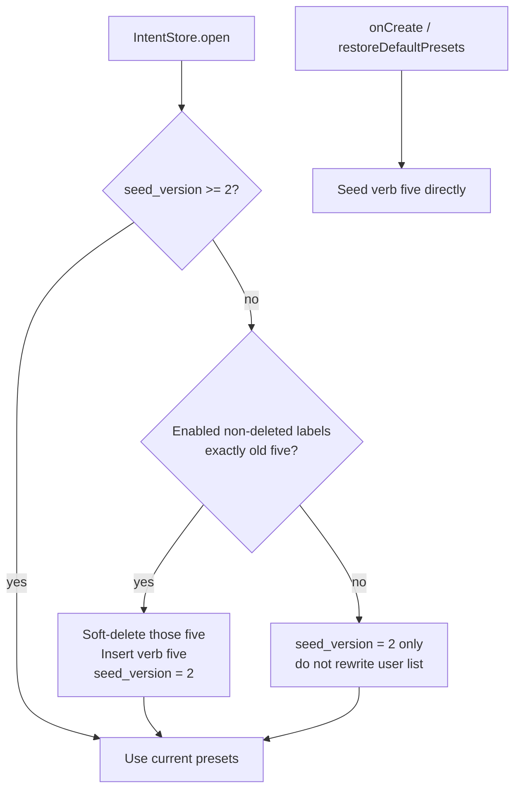

# Verb-based default presets (job-goer TG) — plan

> Status: **built (code); on-device verify pending.** Date: 2026-07-25.
> Trigger: friend feedback — skipped the unlock prompt under urgent work because
> nothing on the capture screen represented that reason; also preferred
> **verb-based** copy over category nouns.
> Owner: Dinesh + Cursor/Claude. Implements against existing `intent_preset` /
> Manage Options / restore-defaults — **no schema version bump** if we only
> change seed labels + an upgrade migration of untouched default sets.

## Update log

- **2026-07-25** — Initial plan: finalize five verbs, keep a single no-bubble
  path, park onboarding picker / suggestion catalog / second no-bubble / voice
  in `docs/BACKLOG.md`. Delay-before-unlock stays strategic-open (no Settings
  "Coming soon" row).
- **2026-07-25 (rev 3)** — **Watch reels** → **Pay someone** (commute/UPI
  coverage). Seed version bumped to 3; untouched v2 verb installs migrate.
  Watch reels parked in suggestion catalog.
- **2026-07-25 (on-device note)** — Installs that already customized the enabled
  set (e.g. added “Testing”) correctly **skip** auto-migration; Restore
  defaults / clear data is the escape hatch. Not a bug.

---

## 1. Product decision (final)

### 1.1 Target group

Primary TG for this pass: **job goers**, validated against one friend’s real
unlock mix (not a generic office stereotype). India-relevant still, but the
enabled five follow **observed taps**, not assumed UPI/WhatsApp/maps.

### 1.2 Copy style

**Verbs / short verb phrases**, not category nouns.

Friend’s raw list (6): Book cab · Order food · Check mail · Call someone ·
Set alarm · Watch reels. We keep **five** enabled defaults (capture-screen
budget + choice-overload); the sixth and near-misses go to the suggestion
catalog backlog.

| # | New default (verbs) | Source | Notes |
|---|---|---|---|
| 1 | **Check mail** | Friend | Covers urgent work better than category “Messages”; narrower than “Check work” but matches how he names it |
| 2 | **Message someone** | Retune | WhatsApp-first TG; replaces Call someone (not everyone likes calls). Call stays in suggestion catalog |
| 3 | **Book a cab** | Friend | Replaces Get directions / Commute — cab is the regular trip unlock; maps/directions are not |
| 4 | **Order food** | Friend | Bring Food Order back as a verb; job-goer lunch/dinner unlocks are real |
| 5 | **Pay someone** | Retune | UPI / transfers — high-stakes commute unlock; replaced Watch reels in defaults |

**Not in the enabled five (park → suggestion catalog / Manage):**

| Label | Why not default |
|---|---|
| Set alarm | Real but low deliberation value; rare vs daily unlocks; easy custom/Manage add |
| Call someone | Friend listed it; broader TG is message-first — catalog, not default |
| Watch reels | Friend listed it; honest doomscroll label — catalog (Pay someone took the fifth slot) |
| Reply to someone / Pay someone | Reply still catalog; **Pay someone is now a default** |
| Get directions / Commute work/home | Friend: directions not regular; “Commute …” reverts toward categories |
| Check social media | See §1.2.1 |

Hard length check: all five ≤ `presetLabelUiMaxLength` (24).

### 1.2.1 “Check social media” / “Watch reels”

**Not in the enabled five.** Prefer adding via Manage / future suggestion catalog
if closed-test users ask. Pay someone took the fifth default slot for UPI
coverage.

### 1.3 One no-bubble path — not two

Concern: two actions that “mean different things” but both end with **no bubble**
feel the same and teach the wrong habit.

| Control | Meaning | Bubble? | `intent_log.kind` |
|---|---|---|---|
| Any preset / custom text | I have a reason | **Yes** | `intent` |
| **Just Like That** | I have no real reason | **No** | `no_intent` |

**Do not ship a second no-bubble control** (e.g. “I’m in a rush”, “Skip for work”)
in this change. That would:

- compete with Just Like That for the same motor pattern,
- collapse urgent-but-real work into the purposeless metric,
- train “tap the bottom escape when busy.”

Urgent mail/work is solved by **Check mail** (and friends can rename/add in Manage).
Voice (later) covers free-form under urgency; it still opens a bubble.

### 1.4 Explicitly out of scope (parked → BACKLOG)

- Onboarding “pick any 8” from a catalog
- Seed a large inactive suggestion list on the capture screen
- Second no-bubble / rush escape
- Voice input
- Changing `maxEnabledPresets` (stays 8)
- Delay-before-unlock UI (see §5)

---

## 2. PRD slice

### Problem

Category presets (Payments / Calls / Messages / Food Order / Commute) miss
high-frequency job-goer unlocks. Users with a real reason hit **Just Like That**
or dismiss mentally — same surface outcome as purposeless unlocks, worse data,
worse trust.

### Goal

Ship a default enabled set of **five verb phrases** tuned to job goers so the
first unlock after install (and after “Restore defaults”) matches common
reasons without onboarding configuration.

### Non-goals

Personalization UI, onboarding preset picker, new outcomes, schema redesign.

### User-facing behaviour

1. **Fresh install** — capture screen shows the five new verbs (enabled), plus
   Just Like That + custom field unchanged.
2. **Upgrade, untouched defaults** — if the user’s enabled, non-deleted presets
   are exactly the old five labels (any order), replace with the new five
   (soft-delete old rows; insert new — same pattern as `restoreDefaultPresets`).
3. **Upgrade, customized** — leave the user’s list alone (any rename, add,
   disable, reorder that diverges from “exactly those five labels enabled”).
4. **Restore defaults** (Manage Options) — soft-deletes current visible set and
   seeds the **new** five (copy in confirm dialog updated).
5. **History** — past rows keep stored `text` / `preset_id`; soft-deleted old
   defaults remain resolvable (existing policy, `docs/DATA_MODEL.md` §7).

### Success signals (friend / closed test)

- Fewer “I skipped because nothing fit” reports for work unlocks.
- Higher share of `kind=intent` vs `no_intent` among self-described busy unlocks
  (qualitative first; quantitative later if opted-in analytics ever lands).

---

## 3. ERD / data impact

**No new tables. No `_schemaVersion` bump required** if migration runs inside
`IntentStore.open()` (or a dedicated `ensureDefaultPresetsMigrated()` called from
open) using SharedPreferences / a row flag — prefer a small prefs key
`default_presets_seed_version = 2` so we don’t overload SQL schema for copy-only
changes.

```
intent_preset (unchanged)
  id, label, sort_order, enabled, deleted_at, created_at, ...
```



**Old five (v1 seed):** `Payments`, `Calls`, `Messages`, `Food Order`, `Commute`  
**New five (v3 seed):** `Check mail`, `Message someone`, `Book a cab`, `Order food`, `Pay someone`  
**Prior verb five (v2 seed):** `Check mail`, `Message someone`, `Book a cab`, `Order food`, `Watch reels`

Constants live in `lib/intent_store.dart` (`_defaultPresetLabels`). Bubble icon
map in `lib/bubble_icons.dart` must recognize the new lowercase labels (and can
keep old ones for historical bubbles).

---

## 4. Acceptance criteria

**AC1 — Fresh install**  
Given a clean install, when the user opens the capture screen, then the five
verb presets appear enabled in seed order, and Just Like That still shows.

**AC2 — Declare still opens bubble**  
Given any of the five verbs is tapped, when submit completes, then a bubble
opens with that text and `intent_log.kind = intent` (not `no_intent`).

**AC3 — Just Like That unchanged**  
Given Just Like That is tapped, when submit completes, then no bubble appears
and `kind = no_intent` (sole no-bubble path).

**AC4 — Untouched upgrade**  
Given an install whose enabled presets are exactly the old five labels, when
the store opens after upgrade, then those rows are soft-deleted, the five verbs
are enabled, and `default_presets_seed_version = 2`.

**AC5 — Customized upgrade**  
Given the user renamed, added, disabled, or otherwise diverged from the old
five, when the store opens after upgrade, then their list is unchanged and only
the seed version bumps.

**AC6 — Restore defaults**  
Given Manage Options → Restore defaults, when confirmed, then the visible list
becomes the five verbs (dialog copy mentions the new set, not “original five”
as Payments/…).

**AC7 — Length / limits**  
Each default label ≤ 24 UI chars; enabling still capped at `maxEnabledPresets`
(8); no change to stored max.

**AC8 — Icons**  
Collapsed/expanded bubble resolves a non-crash icon for each new default label
(Material icon or letter avatar — match existing `bubbleIconFor` policy).

---

## 5. Delay-before-unlock — “Coming soon” in Settings?

**On roadmap?** Only as an **open strategic idea** (`CLAUDE.md` §12) — not
scoped, not committed, distinct from prompt triage (cooldown/probability).

**Put a Settings row that says Coming soon?** **No** for this pass.

Why:

- Creates expectation debt before the mechanic is designed (bypass list,
  schedule, interaction with prompt+bubble).
- Risk of looking like a shipped control that does nothing (trust hit in closed
  test / Play listing).
- Settings is for real knobs (prompts, cooldown, probability, quiet hours).

Park as backlog explore only; when scoped, ship a real toggle — not a tease.

---

## 6. Test plan

### Automated

| ID | Case | Expect |
|---|---|---|
| T-V1 | `onCreate` seeds five verb labels | Labels + enabled + order match `_defaultPresetLabels` |
| T-V2 | `restoreDefaultPresets` | Soft-deletes visible; inserts verbs |
| T-V3 | Migration: DB with exactly old five enabled | After open + migrate, verbs enabled; old soft-deleted; seed_version 2 |
| T-V4 | Migration: user added a sixth preset | List unchanged; seed_version 2 |
| T-V5 | Migration: user renamed `Messages` → `WhatsApp` | List unchanged |
| T-V6 | Migration: already seed_version 2 | No-op |
| T-V7 | Widget: capture screen shows verb labels when fed new presets | `IntentCaptureScreen` / manage restore copy |
| T-V8 | `bubbleIconFor` for each new label | No throw; returns IconData or null per policy |

### On-device (append to `docs/TEST_PLAN.md` when building)

| ID | Case | Expect |
|---|---|---|
| 66 | Fresh install unlock | Five verbs + Just Like That |
| 67 | Tap **Check mail** | Bubble with that text |
| 68 | Just Like That | No bubble; history shows no-intent |
| 69 | Upgrade from build with old five untouched | Verbs appear next unlock without Restore |
| 70 | Upgrade after customizing presets | Custom list preserved |
| 71 | Restore defaults | Confirm dialog + verbs |

---

## 7. Implementation checklist (when building)

1. Replace `_defaultPresetLabels` in `lib/intent_store.dart`.
2. Add `default_presets_seed_version` (prefs) + migrate helper; call from `open()`.
3. Update `restoreDefaultPresets` confirm string in `manage_presets_screen.dart`.
4. Update `lib/bubble_icons.dart` preset set / mappings.
5. Tests in `intent_store_test.dart` (+ manage/widget as needed).
6. Append on-device rows to `docs/TEST_PLAN.md`; mark BACKLOG items parked.
7. One-line note in `docs/PRD.md` feature table / presets bullet; CLAUDE only if
   operational default list is cited elsewhere as Payments/….

**Do not touch Kotlin** for this change.
